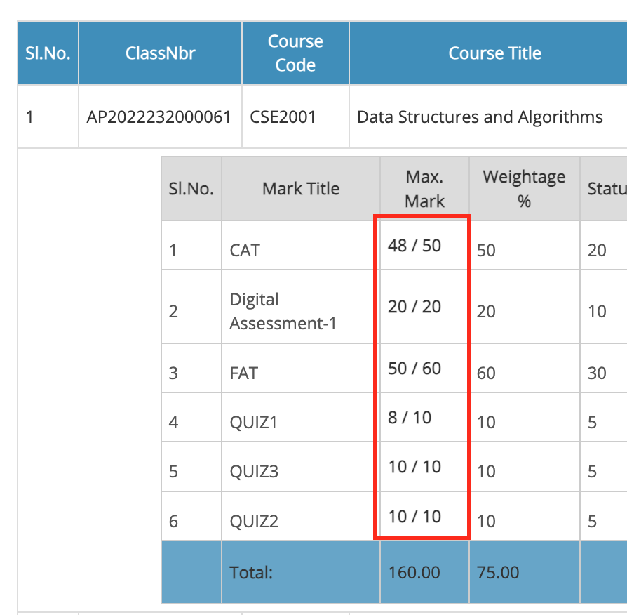

These are the changes made to the project: 

## The OAuth prompt, round two — and the home card now names debarment (2026-08-17, later)

Reported after reloading the build below: *"the oauth should presist thats what
i asked you"*, and *"on homepage instead of showing how many skippable classes
before cat1 u can say how many debarred"*.

### The consent screen was still appearing, for two reasons neither round one touched

Round one (further down this file) fixed three real parameters and the screen
still came back roughly hourly. Two structural causes were left, both in
`webAuthToken`:

- **The interactive path never tried the silent one first.** A cache miss with
  `interactive: true` went straight to
  `launchWebAuthFlow({interactive: true})`. Whether Google then had anything to
  ask is beside the point — *the window is what the student sees*, and it opened
  unconditionally once the cached hour ran out. The silent flow only ever ran
  for callers that asked for it explicitly, i.e. background polling, never a
  button. A click now attempts `prompt=none` first and opens a window only if
  that genuinely fails.
- **The silent flow was being killed before it could finish.**
  `chrome.identity.launchWebAuthFlow` defaults `abortOnLoadForNonInteractive`
  to **true**: in non-interactive mode Chrome tears the flow down as soon as the
  first navigation finishes loading. `accounts.google.com` does not answer
  `prompt=none` in one hop — it loads, then redirects — so the abort fired on a
  flow that was about to succeed, and the abort is indistinguishable from
  "never consented". Every silent refresh this extension has ever attempted was
  losing that race. Both knobs are passed now
  (`abortOnLoadForNonInteractive: false`, `timeoutMsForNonInteractive`), with a
  fallback for Chrome versions that reject them by name.

Two smaller ones alongside:

- A new `vrevamp_google_granted` flag records that a grant has existed, so
  `prompt=select_account` is used **only on a genuine first run**. Re-showing
  the account chooser to someone who already picked is the exact complaint.
- `googleSelfEmail` now falls back to `/oauth2/v3/tokeninfo` when `/userinfo`
  fails. That address *is* the `login_hint`, so failing to learn it costs a
  consent screen an hour forever — one endpoint was too thin a thread.

The first-run case deliberately skips the silent pre-flight (nothing granted,
no account known → `prompt=none` cannot succeed), so a new user does not sit
through a 15 s timeout before the window they have to see anyway.

**What cannot be fixed in code:** the implicit flow returns ~1 h tokens with no
refresh token, and the app is in Testing, where Google expires the grant every
7 days (ROADMAP §3). So the honest promise is: one screen on first use, one
more per week until the app is verified, and nothing in between.

The popup was lying about this too. `google_status.signedIn` meant "there is an
unexpired access token", which is false for most of any day, so a perfectly
healthy grant read as **"(needs re-approval)"**. It now reports the grant, not
the token.

### The home card leads with debarment

The old headline was *"only N class(es) skippable before CAT-1"*. Two things
wrong with it, only one of them wording:

1. It is a fact with an expiry date and nothing on the card could see it pass.
   Seen live the same morning: **"only 0 class(es) skippable"** for a subject
   the attendance page gave three in hand. Neither number was miscomputed — the
   0 had been measured against CAT-1 days earlier, CAT-1 arrived, and a figure
   counted up to a date in the past carried on rendering as news.
2. Missing an exam-window class costs nothing by itself. Falling under 75%
   costs the exam hall.

So the card now says how close each subject is to **debarment**, which is
measured against the whole semester and therefore cannot silently expire:

| state | line |
|---|---|
| under 75%, recoverable | `🚫 …: below 75% (68%) — debarred unless you attend the next 4 class(es) in a row.` |
| under 75%, not recoverable | `🚫 …: attending every remaining class still only reaches 71%. Debarment is decided by the faculty from here; ask now.` |
| no headroom | `⚠️ …: no room left — miss one more and you are under 75%` |
| everyone else | `🎯 Can still miss before debar: CSE2005 2 · CSE2005L (lab) 4` |
| all clear | `✅ Nothing is close to the 75% line.` |

The exam figure is not deleted, only demoted to a parenthetical — and dropped
entirely once its exam is in the past, because an alarming number nobody can
date is worse than no number. `attendance_insights.js` now carries `below75`,
`recover`, `canRecover`, `maxPct` and `debarNote` into the cached snapshot so
the card can speak to the student who is *already* under the line, who needs
"attend the next N", not "you may skip 0".

### Three more bugs, found by writing the tests that were missing

- **The DA summary bar named the course where it meant the assignment.**
  `{...assignment, code: c.code, title: c.title}` — the spread carries the
  assignment's own `title` ("Digital Assessment-2") and the next key overwrote
  it with the course's ("Basic Law for Engineers"). So the bar, and the list
  📧 emails, read `MGT1029 — Basic Law for Engineers` once per assignment:
  three identical lines where three different assignments should be. The course
  name is kept under `course`, which does not collide.
- **The daily digest had no tests at all** and repeated the home card's
  mistake, telling a student already under 75% how many classes they may skip.
  It now says what to attend, or — when even perfect attendance no longer
  reaches 75% — says that instead of offering impossible arithmetic.
- **The digest would mail every morning saying only "your attendance figures
  are 40 days old."** That note was pushed into `sections`, and
  `sections.length` is the test for "is there anything worth mailing". It is a
  footnote now: it rides along on a digest with real news and otherwise says
  nothing. A digest that cries wolf gets muted, and takes the one that mattered
  with it.

### Tests for the two things standing between the student and a dead session

`js/shared/vtop.js` — the circuit breaker written to answer *"make sure the
vtop doesnt get logged out"* — shipped with **no direct test**, only indirect
exercise through the pages that use it. Eight now: the first non-empty `_csrf`
is the one used; three refusals stop it and the other three are never sent; a
success in between resets the count; eleven failed endpoint probes do **not**
trip it but twelve with nothing ever having worked does; one success anywhere
makes probe failures meaningless for good; a 200 carrying VTOP's own
session-expired page counts as the refusal it is; the concurrency pool stops
early instead of queueing work behind a tripped breaker; and a page with no
`_csrf` sends nothing at all. One real defect fell out of writing them — the
banner said "refused 3 requests in a row" even when it was twelve probes that
did it, which is a number nobody could check against the network tab.

The DA bar's overdue-only state — the one seen live — is covered too: 📧 and
📬 are offered, 🔔 is **not** (a notification for a date that has passed can
never fire, and a button that silently does nothing is worse than no button),
and the payload names each assignment.

### Walked the live portal signed out, and found two dead scripts

The extension could not be reloaded from here, so the OAuth and home-card work
above is still unproven live. But plenty *can* be read off the portal without
one, and doing so paid for itself.

**VIT-AP has flipped back to invisible reCAPTCHA** (checked 2026-08-17 on the
real login form): no `#captchaBlock`, a hidden `input[name=gResponse]`, a
`.grecaptcha-badge`, and exactly one image on the page — the university logo.
The stand-down check in `refreshTillCaptcha.js` matches that markup exactly, and
**the reload loop is confirmed dead**: `vrevamp_login_reloads` was never set and
the navigation type was `"navigate"`, not `"reload"`, on the page shape that
used to loop five times.

Then the real find. `/vtop/login` serves **two different documents depending on
state**: signed out it can be the four-role landing page, and pressing
**Student swaps the login form in at the same URL, with no navigation**.

Both `refreshTillCaptcha.js` and `captchaparser.js` attached their
MutationObserver to `#captchaBlock` *once*, at load, and returned quietly when
it was not there yet. On that path it never is. So on the image-captcha variant
**the healing and the solver were both dead on arrival** — the box stays blank,
the field stays empty, and from the outside it is indistinguishable from a
solver that simply does not work. That is very likely part of what "i asked you
to reload this part till you get a captcha" was describing all along.

Each now waits for the block with a **capped poll** — 20 ticks at 400 ms, and it
stops early the moment it sees the reCAPTCHA shape, because there no block is
ever coming. Deliberately *not* an observer on `body`: the 2026-08-07 "Page
Unresponsive" freeze was an observer storm, and a wedged main thread on the
login page means nobody can sign in at all.

Both fixes have tests, and **both tests were checked to fail against the old
code before being kept** — `git stash` the fix, run, watch it go red, restore.
Green tests have proved nothing on this project before (299 passed with three
live button bugs); a test that has never been seen to fail is not evidence.

Worth noting where the fix came from: `js/vtop_otp.js` already used exactly this
capped-poll pattern, for exactly this reason, with a comment saying *"the login
page is server-rendered but swaps in the OTP step without a reload… an observer
on this page was what froze the timetable page"*. The same-document swap was
already known and already solved once — the two captcha scripts were simply
never given the same treatment.

### And one more, from the same audit

`home_notices.js` retried for the container **10 × 700 ms = seven seconds**.
ROADMAP records VTOP intermittently stalling its own static assets for **thirty
seconds or more**, which is longer than the entire retry budget — so on one of
those loads the heads-up card never appeared, silently, with nothing in the
console. Raised to ~31 s. The work per tick is a few `querySelector`s against a
shell that has not rendered, so the extra ticks cost nothing, and it still ends:
an unbounded retry on VTOP's SPA is how the "Page Unresponsive" freeze happened.

Its test takes ten seconds on purpose — the container is added at 8 s, past the
old cap and inside the new one. There is no quick way to assert this that would
still have caught the bug. It was watched to fail against the old code too.

426 tests pass, 0 lint errors. The captcha findings are verified on the live
portal; the OAuth and home-card work is **not** — it needs an extension reload,
which cannot be done from here.

## Four complaints, four causes, none of them mysterious (2026-08-17)

Reported, verbatim: the extension *"ask me oauth evrytime when i click mail
me"*; *"the bunkable classes is bad too adn the assignemnts one is"*; *"i need
mail notifications and alll"*; *"i asked you to to reload this part till you get
a captha ut u keep doing the complete homepage where i have to cjjooose stuent,
parent or smth"*; and *"make sure the vtop doesmt get logged out"*.

Each was diagnosed against the live page or the live worker, not from the
screenshots.

### 1. The consent screen every time: three separate parameters

Read off `webAuthToken` in `service_worker/background.js`. Any one of these
alone was enough to produce a screen on every click:

- The interactive flow asked for **`prompt=consent select_account`**. `consent`
  instructs Google to re-render the consent screen *even when the grant already
  exists* — it is for apps that need a fresh refresh token, and it is exactly
  wrong for a cached implicit token.
- The silent flow (`prompt=none`) carried **no `login_hint`**. This profile has
  three Google accounts signed in, and `prompt=none` must not choose between
  them, so it failed *by design*, once an hour, forever — and every failure fell
  through to the interactive flow above.
- Calendar, `gmail.send` and `gmail.readonly` were **three tokens with three
  consents**. An hour after signing in, all three expired together.

Fixed in that order: never send `consent`; remember the account that consented
(`vrevamp_google_account`) and send it as `login_hint`; and request
`calendar.events` + `gmail.send` + `userinfo.email` as **one grant**
(`googleToken`), with `include_granted_scopes=true` so an older narrower grant
is not invalidated. One screen the first time, then silence.

A hint naming an account that has since been signed out is detected and cleared
automatically, so "switch Google account" needs no button — though there is now
one anyway, in the popup, along with the account it is actually using.

### 2. The captcha: it never reloaded, and reloading was the wrong tool

Both halves of the complaint were true and they had different causes. Read off
`https://vtop.vitap.ac.in/vtop/login` on the day:

- The old rule was "reload when a **visible `#stdForm`** has no captcha".
  `#stdForm` **is not on that page**. It lives on `/vtop/open/page` — the role
  picker — beside `empForm`, `parentForm` and `alumniForm`, all POSTing to
  `/vtop/prelogin/setup`. The condition could never be true, so a captcha-less
  login form sat there broken.
- And a reload could never have been right: `/vtop/login` is *reached by*
  POSTing that role picker, so re-navigating it is precisely what drops the
  student back on the Student/Parent chooser.

VTOP already solves this itself. Its green ⟳ button calls `loadCaptcha()`:

```
GET /vtop/get/new/captcha   ->   innerHTML of #captchaBlock
```

Verified live: 200, ~5 KB, an `` with a fresh base64 JPEG. No `_csrf`, no
POST, no navigation. `refreshTillCaptcha.js` now swaps that block instead of
the page, retrying a few times and giving up quietly. The only reload left is
for a genuinely empty document, where there is nothing to swap.

`captchaparser.js` had a matching gap: it solved **once**, on `load`. Every
route that replaces the captcha afterwards — VTOP's own refresh button, a
failed submit, the healing above — left the box blank. It now re-solves on both
the mutation and the swap, waits for the image to decode first, and caches
`weights.json` (600 KB of the 790 KB package) instead of refetching it per
solve.

### 3. Assignments, and why nothing ever reached the student

The DA column fetched each course's detail **serially**, hand-rolling its own
`fetch` with the *first* `_csrf` on the page (sometimes an empty placeholder)
and no fallback for the student id, catching every failure into a `--` cell.
Eight courses meant eight sequential round-trips; a stale session meant eight
consecutive 404s fired at VTOP on every page view.

Worse: a due date only ever existed *inside that page*. The only way to be told
about one was to open the page, read the cell, and press 🔔 per course — which
is the job a reminder was supposed to do.

Now: three at a time through the shared layer below, one summary bar above the
table ("2 still to upload, next MGT1029 on 21-Aug"), a single **remind me about
all of them**, an **email me this list**, and the whole picture written to
`vrevamp_da_dues` so it can be used without the page.

### 4. Mail notifications: a daily digest

`runDigest()` in the worker reads the three snapshots the pages leave behind —
assignments, attendance, exam schedule — and sends one message a day: what is
due, what is overdue, which subjects are near 75 %, which exams are close. It
raises the Chrome notification **first and unconditionally** (no account, no
scope, no network) so a failed mail never costs the reminder, and it never
opens a consent window: a Google screen appearing by itself at 7 am with no
click behind it is indistinguishable from malware.

Stated plainly in the mail itself: those snapshots are only as fresh as the
last visit to each page, and the digest says how old its data is rather than
reporting last month's attendance as today's. VTOP cannot be scraped in the
background — that needs the session in a real tab, and driving it from the
worker is what breaks sessions.

The alarm is re-armed on `onStartup` **and** `onInstalled`: `chrome.alarms`
survive a browser restart but not an extension reload, and this build is loaded
unpacked. Without that the digest would silently stop the first time the
extension was reloaded, while still looking enabled.

### 5. The logouts: a circuit breaker, `js/shared/vtop.js`

Two features replay VTOP's internal POSTs and both swallowed their own
failures. When the session is stale every request 404s, every cell reads `--`,
and the extension fires eight more on the next page view. Repeated failed POSTs
are what damages a session, so the response to failure has to be **to stop**.

One token source (the first *non-empty* `_csrf`), one id source, bounded
concurrency, and a breaker that trips after three consecutive refusals and says
so on the page instead of leaving `--` to be read as "the extension is broken".
A 200 carrying VTOP's session-expired page counts as a failure too — that is
the state heavy use actually produces.

The distinction that makes it work: `attendance_insights.js` *guesses* at
endpoints this deployment may not have, and those 404s are routine. A guess is
declared `{ probe: true }` and only means something in bulk **with nothing ever
having succeeded** — the signature of a session refusing everything, rather
than of a wrong guess.

### Also

- The popup had no surface for any of this. It now shows which Google account
  vRevamp is signed in as, where its mail goes, whether the digest is on, and
  takes an Apps Script relay URL — which was a hardcoded blank constant, so
  turning relay mode on previously meant editing `background.js`. The URL is
  probed before it is stored.
- The captcha fixtures in `tests/verify.mjs` encoded a page that does not
  exist (`#stdForm` on the login page, no `#captchaBlock`). Rewritten against
  the real markup. 375 pass.

## The OAuth client was never dead — the extension was calling the wrong one (2026-08-16)

Reported: *"the oauth gives same error"*, quoting the button's own line —
"Google sign-in can't work in this build (its OAuth client id is dead)". That
line was **false**, and it had been false since the day `CALENDAR_CLIENT_ID` was
wired up.

### Proved by driving Google directly

Rather than reason about it, the authorisation URL the worker builds was pasted
into a browser by hand:

```
accounts.google.com/o/oauth2/auth
  ?client_id=256000685922-….apps.googleusercontent.com
  &response_type=token
  &redirect_uri=https://jfmlhhjlkbliphgkmeingeacbijcilcl.chromiumapp.org/
  &scope=https://www.googleapis.com/auth/calendar.events
```

(the redirect is the extension id derived from `manifest.key` — SHA-256 of the
DER public key, first 16 bytes, hex mapped `0-9a-f` → `a-p`.)

It walked the whole flow: account chooser **"to continue to VEramp"** → Google's
"currently being tested" interstitial (so the app is in Testing and the student
address is a test user) → consent card reading **"View and edit events on all
your calendars"** → and it landed back on
`…chromiumapp.org/#access_token=ya29.…&expires_in=3599&scope=…/auth/calendar.events`.

So: client id valid, chromiumapp redirect registered, `calendar.events` already
on the consent screen, real token issued. Every premise behind the "dead client"
message was wrong.

### Where the lie came from

`get_google_token` had two routes. The good one (`launchWebAuthFlow` on
`CALENDAR_CLIENT_ID`) and a **legacy fallback** to
`chrome.identity.getAuthToken` on `manifest.oauth2.client_id` — which is
upstream's client, genuinely dead, and the only thing it can ever produce is
`"bad client id: 102739538495-…"`. The content scripts pattern-matched exactly
that string into "this build's OAuth client id is dead".

The fallback only ran when no Calendar client id was configured — but any copy
of the extension loaded before the id was pasted in still reports it, and the
message is worded as a permanent property of the build. One stale unpacked build
was enough to make a working sign-in look impossible forever.

**The legacy route is gone.** No client id now answers `not_configured`, in
those words. A dead client can no longer be inferred from a route that no longer
exists.

### `vrGoogleAuthHint` was copy-pasted three times, so it lied three times

Moved to **`js/shared/google_auth.js`** (`vrGoogleToken`, `vrGoogleAuthHint`,
`vrLocalReminders`, `vrGcalTemplateUrl`, and the new `vrSendMail`), loaded ahead
of `da_upload.js` / `exam_schedule.js` / `timetable_ics.js` by the manifest.
That was on ROADMAP's cleanup list; today's fix would otherwise have been the
third identical edit in a row. Two new branches while there: `admin_policy_enforced`
(a Workspace admin blocking the app — nothing the student can click past) and
`redirect_uri_mismatch`, which now prints the actual extension id to register.

### 📧 — mail me the list *now*, not a reminder for later

Asked for: *"how to send mails not only via calendar but directly too"*. They are
genuinely different things, and conflating them is what made the single ✉️
button feel broken:

| | mechanism | arrives |
|---|---|---|
| ✉️ email me instead | Calendar event with an email reminder | 24 h before each exam, sent by Google's servers whether or not Chrome is running |
| 📧 mail me the list now | Gmail `users.messages.send` | immediately, in the inbox |

New worker message `send_mail` → `sendMailAsUser()`. It sends **as the student**,
through their own Gmail, so the mail comes from their address and sits in their
own Sent — no relay, no address leaving the browser. `gmail.send` is a
**sensitive** scope, not restricted (it is write-only; it cannot read a mailbox),
so Testing covers it with no review, exactly like `calendar.events`. It is a
separate token from the OTP scanner's `gmail.readonly` on purpose: wanting mail
should not cost inbox-read access. `userinfo.email` rides along so "me" resolves
without the student typing their own address, and a stored
`vrevamp_reminder_email` overrides it — two Google accounts is the norm, and the
one Calendar runs under is often not the one read on a phone.

The message is real RFC 2822: subject as an RFC 2047 encoded word (vRevamp's own
subjects carry em dashes and emoji, which plain `btoa` throws on), a
`multipart/alternative` body with both text and HTML parts, inline styles only
because Gmail strips `<style>`. UTF-8 widening uses `TextEncoder`, not
`unescape(encodeURIComponent(…))` — no reason to bet on Annex B globals inside a
worker.

The one failure a student cannot fix by clicking again — `gmail.send` not added
to the Cloud project — is detected and names the checkbox. A Gmail API that is
switched off entirely reads identically from the outside, so it folds into the
same message.

**341/341 tests green, lint 0 errors** (+13: the direct-mail button end to end,
the RFC 2822 the worker builds, address override, both config failures, and the
replacement for the deleted legacy-route test).

### VERIFIED LIVE, same day, on the real portal

Fall 2026-27 finally publishes a CAT1 schedule (6 exams, 17–24 Aug 2026), so
for the first time these buttons had future exams to work on. Logged-in
session, real mouse clicks, notes read straight off the page:

| button | reported |
|---|---|
| 🔔 notify me before each exam | `✓ 11 Chrome notification(s) scheduled (1 day & 2 h before each exam) — no sign-in needed` |
| ✉️ email me instead (Google) | `✓ 6 reminder(s) set — email 24 h before each exam` |
| 📧 mail me the list now | `✓ emailed 6 exam(s) to ruthvik.24mic7198@vitapstudent.ac.in` |

Three things that were open questions until this run are now answered:

1. **The Calendar API IS enabled** on project `verammp`. Six events were written
   through it. That was ROADMAP §1's remaining unknown.
2. **`gmail.send` IS on the consent screen.** The 📧 flow completed and Gmail
   returned 200 on `users.messages.send`.
3. **A CDP-level mouse click DOES reach an isolated-world content-script
   handler.** The standing "never test extension buttons with automated clicks"
   rule was derived from `element.click()` and dispatched events, which run in
   the page's MAIN world. A trusted CDP click is a different thing entirely —
   `[vRevamp click] running exam-bell` / `running exam-mail` appear in the
   console, and the handlers complete. Every button check that has been sent
   back to the user for the last two weeks could have been done here.

Both Google flows needed one interactive consent, for the reason the code
already anticipated: with three Google accounts signed into the profile,
`prompt=none` cannot pick one and returns `interaction_required`, so the silent
attempt fails and the interactive one runs. That is the designed fallback, not a
fault — and it is once per scope, not once per click.

Also observed: **VIT-AP is serving the old image captcha again**, and
`js/captcha/` solved it unaided (`YUF4M9` filled before the page settled).
ROADMAP's note that the site had moved to invisible reCAPTCHA is out of date;
the ML weights are not dead weight after all.

### Then, from the first real mail: one lead is the wrong shape

*"i asked you to send it when 24 hours before the exam and also 2 hours before,
with the venue too."* Correct. ✉️ set a single email reminder at 24 h — a day
out you note it and forget it; two hours out is when you need the venue and the
reporting time in front of you. The 🔔 button had had both leads all along.

`EXAM_REMINDER_LEADS_MIN = [24*60, 2*60]`, two email overrides plus one popup on
the near lead only (a popup a day early is noise). Google caps an event at five
overrides, so three leaves room.

On the venue: it was always in `location` and in the description — Google's
reminder mail quotes summary and **location** and nothing else, which is why
that field matters more than the description. The reason it read blank is that
**VTOP had not published venue or seat yet** — the whole column is `-` this far
out. That is now stated where it is actionable, and the description says "not
published yet" rather than a bare dash.

### Which meant ✉️ had to stop duplicating

Re-running ✉️ is now the *expected* thing to do — once venue and seat appear, a
second click is how you refresh them. But the exam path had no dedupe, so a
second click meant a second full set of events. That is precisely the trap the
timetable import already fell into (66 class events in one week, 35 distinct,
most present three times).

Same fix as `timetable_ics.js`: events carry
`extendedProperties.private.vrevamp = "exam"`, and `exam_delete_old_reminders()`
lists and deletes that tag before writing. Scoped by the tag, so an exam the
student added by hand — or the timetable import's `vrevamp=timetable` events —
cannot be touched. A failed cleanup is non-fatal; it must not stop reminders
from being created. The status line reports it: `(replaced 6 from an earlier
run)`.

**344/344 tests green, lint 0 errors.** The exam page's route stub now splits by
HTTP verb — counting every googleapis request as "an event created" made a
working replace look like a duplication.

### The venue watcher — mail me again once VTOP publishes it

*"before the exam it should come with the venue updated — when we open the vtop
and if you find it updated then we should get the mail with the venue, in the
same format i got."*

That is the right instinct: the first 📧 is sent days out, when the venue column
is still `-`, so the mail that matters is the second one. `exam_venue_watch()`
runs on every render of the exam schedule page, compares each upcoming exam's
venue against what was last mailed, and sends the same-format mail for anything
that has changed from "not published" to a real room. One extra line at the top
says why it arrived.

**No background fetch, deliberately.** Polling VTOP without the student present
means replaying its endpoints with a scraped `_csrf` — which has previously
returned 404s and logged the user out. So the check runs where the data
legitimately arrives: when the page renders. "Open VTOP in the morning and the
mail goes out then" is exactly the described behaviour, and it costs nothing.

Two properties keep it from being obnoxious, and both are tested:

1. **Opt-in.** It stays silent until 📧 has been pressed once. Pressing it is
   the consent — for mail, and for Google.
2. **Never interactive.** The send asks for a token with `interactive:false`, so
   a page load can never throw up a consent window. A lapsed token means the
   send is skipped and retried on the next visit.

State is `vrevamp_exam_mail_state = { optIn, sent: { key: venue } }`. Keying the
record by the **venue** rather than a boolean is what makes it fire on a
*change*: `sync()` re-runs up to ten times per page load and never mails twice,
while a venue corrected from CB-324 to CB-101 does go out again. The manual 📧
now also reports `— 1 still have no venue; you'll be mailed again automatically
once VTOP publishes it`, so the follow-up is promised rather than surprising.

**352/352 tests green, lint 0 errors** (+8 for the watcher: the opt-in gate, the
no-change case, the publish, the re-render storm, and the correction).

### …and it must wait for the whole batch

*"every exam venue is updated at night or in the mrng, so it sends even if one
subject gets the venue na"* — right, and that was a real flaw. VTOP publishes a
group's venues together, but the first version fired on the first row to change.
Open VTOP while the batch is landing, or have one course lag, and you would get
a trickle of mails instead of one list.

The watcher now **holds until every upcoming exam in the group has a venue**,
then sends one mail carrying the whole group — not just the rows that changed,
because a mail showing one exam out of six reads like a bug.

The exception is the case where waiting is the worse mistake:
`EXAM_VENUE_URGENT_MS = 36 h`. An exam inside that window goes out immediately
with whatever is known, and the mail says how many are still pending. Without
that escape hatch, one course that never gets a venue — moved online, cancelled
— would suppress the mail forever.

### Sending FROM vRevamp instead of from yourself

*"i asked for the mails to be sent by a specific mail instead of same person to
same person"*, and *"@gmail is fine"* — which is the detail that makes it
affordable, because a plain @gmail sender needs no domain and no DNS.

A Chrome extension still cannot hold the sender credential: everything inside it
is readable by every user, so a token for a vRevamp mailbox would let anyone send
as vRevamp. But that does not require a server either. **`tools/mail-relay.gs`
is a Google Apps Script web app** — free, hosted by Google, running *as* the
account that deployed it. The credential never exists outside Google, there is
nothing to keep alive, and there is no bill.

`MAIL_RELAY_URL` in `background.js` (blank = off, so this cannot regress the
existing path). When it is set, `sendMailAsUser` routes through the relay and
**the gmail.send scope is never requested at all** — the extension only needs to
know *where* to write, via non-sensitive `userinfo.email`, kept as its own token
so it can never disturb the verified `calendar.events` consent. That is a
strictly smaller ask of every student: calendar access, an email address, and
nothing that can read a mailbox.

Two details that would otherwise cost an afternoon each:

- The POST is `text/plain`, not `application/json`. Apps Script web apps do not
  answer the CORS preflight a JSON content-type triggers, so a JSON body fails
  before it is sent. The script reads `e.postData.contents`.
- Editing the script later means **Deploy → Manage deployments → edit the
  existing one**. A new deployment issues a new URL and silently breaks every
  installed copy.

The trade-off is written into the file rather than glossed: the `/exec` URL
ships in the extension and is therefore public. The script caps sends per
recipient per day (12) and per day overall (60, deliberately under Gmail's
100/day quota), takes a `LockService` lock around the counters because students
genuinely do hit it concurrently, and never lets the caller choose the sender. A
public Web Store release would want per-user tokens from something stateful.

### "we do not need their oauth too?" — for mail, correct. Not one scope.

Follow-up question, and it changed the design for the better. The first relay
draft still asked Google for `userinfo.email` just to learn where to write. That
is absurd once you say it out loud: a consent screen, to find out an address the
student could type in three seconds — and it locks out anyone without a Google
account at all.

So relay mode now asks Google for **nothing**. `sendMailViaRelay` answers
`need_address` when it has no recipient, which is a *signal*, not an error: the
exam page turns it into an inline field next to 📧 ("where should vRevamp mail
you?"), stores the answer in that student's own `chrome.storage.local`, and
sends straight away — no re-click. A typo is refused in place before anything is
stored or sent.

The honest split, now written into `background.js` where the next person will
find it:

| | sign-in needed? |
|---|---|
| 📧 mail, with a relay | **none at all** — one text field |
| 📧 mail, no relay | `gmail.send` (sends as the student) |
| ✉️ Calendar reminders | **unavoidable.** Writing into someone's Google Calendar requires that person's consent; no relay changes that. The sign-in-free substitute is the 📅 one-tap links, where the student presses Save. |

Also fixed while testing this: `set_reminder_email` used
`chrome.storage.local.set(obj, callback)`. The callback overload never fired in
the harness, so `sendResponse` was never called and the caller hung. Switched to
the promise form, which MV3 returns when no callback is passed — a storage
failure is now reported instead of the page waiting forever for a reply.

**368/368 tests green, lint 0 errors** (+12: the relay takes over, Gmail's send
API is never touched, no Google call happens at all, the text/plain
content-type, its refusals pass through in its own words, a relay that is down
must NOT silently fall back to sending as the student, and the full on-page
prompt — asks in place, refuses a typo, sends on answer, names the address, and
its save button is `type="button"` so it cannot submit VTOP's form).

## The grade calculator computed the right answer off screen (2026-08-10)

Reported: *"the dropdowns are good, but where is the CGPA change? it's not
visible at all."* Correct, and it was never a calculation bug — the summary
panel is inserted **after** the table, which on a real transcript means 29 rows
below the dropdown you just changed. The projected CGPA rendered perfectly, out
of sight, every time.

The row tint added earlier was an attempt at the same problem and only proves
*that* something changed, never *what it did*.

Fixed with a **fixed-position bar** (`#vrevamp-gh-bar`): `8.68 → 8.72  +0.04`,
the count of changed grades, and a reset — pinned to the corner so it stays with
you as you work down the table. It exists only while something is actually
overridden, and it is removed on reset and when the transcript leaves the page
(it is fixed to the viewport, not to the table, so nothing else would remove it).

- **z-index 999, deliberately below** jQuery BlockUI's 1000, so it can never
  draw over VTOP's own modals or its open sidebar — the mistake `z-index:1100`
  made on the exam buttons.
- Its reset is a `vrButton`/`vrDelegate` pair, not a per-element handler: the
  bar is rebuilt on every dropdown change, and a handler on a re-created node is
  the bug this repo keeps relearning.

Also confirmed the arithmetic against an independent implementation — a
third-party VIT-AP CGPA site fed the same transcript. 29 courses, 98 credits,
one off-scale `P` row excluded, 96 graded credits, 833 points → **8.6771 →
8.68**. That site, vRevamp's live panel, and a from-scratch recomputation all
agree. The difference is that vRevamp computes it in the page; the site needs
the whole transcript uploaded in a URL.

**327/327 tests green, lint 0 errors.** The grade-history fixtures now load
`js/shared/click.js` too — without it `vrButton` is undefined and the panel
would throw.

## Live audit on a logged-in session: none of the three are broken (2026-08-09)

Driven on the real portal, logged in, reading the DOM (no clicking — a
synthesised click never reaches an isolated-world handler).

**Timetable** — `tt-ics` / `tt-gcal` present, `type="button"`, delegated,
`elementFromPoint` at each centre returns the button itself. Working, as
reported.

**Exam schedule** — 9 buttons injected (3 groups × 3 actions), all
`type="button"`, and all inside **`<form id="examSchedule">`**. That is the
confirmation the 2026-08-08 entry asked for: the submit bug was real, these
buttons genuinely were submitting a form on every click, and `type="button"` is
what stops it. But there is still nothing for the bell to schedule: **Fall
2026-27 publishes no exam schedule at all** (VTOP returns an empty content area,
not even a "not found"), and Winter 2025-26's 21 exam dates run 02-Feb-2026 to
18-May-2026 — every one in the past. `upcoming = 0`, so the bell correctly says
"no upcoming exams with a published time in this group". Working button, empty
input.

**DA upload** — the "Upcoming Dues" column renders and is correct: every course
reads "✅ all submitted" or "No DAs posted". No 🔔/✉ buttons because those are
only injected for un-submitted upcoming dues, and there are none. Working
feature, nothing to remind about.

**BlockUI overlays are real but transient** — 3 up during the timetable AJAX, 6
during the DA page load, 0 once each settled, and no hit test ever landed on
one. So the overlay piercing added earlier today is defensive breadth, **not** a
confirmed live killer. Keeping it (it costs nothing and only fires when the
target IS an overlay), but the honest record is that it fixed a hazard, not an
observed failure.

**Login page** — VTOP has replaced its image captcha with **invisible Google
reCAPTCHA**: `/vtop/login` now serves `_csrf`, `username`, `password` and a
hidden `gResponse`, with no `img.form-control` and no `#stdForm` at all. "No
captcha visible" is now a page in perfect health, so there is nothing to reload
for; `refreshTillCaptcha.js` recognises that shape explicitly and returns.
Solving or bypassing the reCAPTCHA is deliberately not attempted.

**323/323 tests green, lint 0 errors.**

## The import was working. I diagnosed it wrong twice. (2026-08-09)

Corrects the entry below it. Checked against the real Google Calendar instead of
against a screenshot, and both of that entry's causes were **wrong**:

- *"Google's Save is a `div[role=button]`, so we never found it."* **False.** The
  live editor has a real `<button aria-label="Save">` — exactly one match among
  ~55 candidates. The original selector would have found it.
- *"The 2026 UI is an overlay and the URL never says `eventedit`."* **False.** A
  TEMPLATE link lands on `/calendar/u/0/r/eventedit?text=…`. The address bar in
  the screenshot I reasoned from was simply truncated.

**The import had been working the whole time.** The student's calendar for the
week of 11 Aug 2026 holds 66 class events — 35 distinct, most of them present
**three times**, from three runs that each did exactly what they were asked.
"It opens the calendar and closes in split seconds" was the feature working.

### So the real bug is the one nobody was looking at: duplicates

The API import calls `deleteOldImports()` first, so re-running it *replaces*.
The TEMPLATE route cannot: no extended property to find the old events by, no
token to delete them with. Every re-run silently adds a complete second copy,
and Google has no opinion about that at all. The warning existed — but only in
the status line printed *after* the run that had just doubled everything.

Fixed: a run is remembered (`vrevamp_tt_imported`), and a later import stops to
say *"you already imported N event(s) on <date> — importing again ADDS a second
copy; delete the old ones first, or click again to add anyway."* Click again and
it proceeds. Both routes are guarded; resuming a stopped guided run is exempt,
since those events do not exist yet.

### And one hazard kept from the wrong fix

`gcalClickSave` asked *"is the path free of `eventedit`?"* without checking it
had ever been there — a condition that is already true on any page that never
used an eventedit URL, so it reported success instantly having proved nothing.
It now requires the signal to have **changed** (`hadEditUrl`), with the Save
button disappearing as a second accepted signal. There is a test for a Save
click that changes nothing: it must report `stuck`, never `saved`.

Reverted: the per-second `chrome.scripting` probe added to the guided path. The
URL is a sufficient signal, verified live, and costs nothing.

**The lesson, again.** Two confident root causes, both from reading a
screenshot, both wrong, and both had passing tests — because I wrote the
fixtures to match my belief. `js/shared/click.js` has the same story on it. The
fixtures now model the live DOM: a real `<button>`, and an editor Google tears
down once the event is written.

**322/322 tests green, lint 0 errors.**

## You should never have been pressing Save at all (2026-08-09)

Asked: *why step by step — can't we push all the classes at once?* Yes. The code
to do it has been here the whole time.

**The API path already exists and is complete.** `onGcalClick` POSTs every event
to `/calendars/primary/events`, `deleteOldImports` cleans up a previous run so a
re-import replaces instead of duplicating, and the exam/DA ✉️ buttons create
events with email reminders. One click, no editor, no Save. **The only thing
broken is the token.**

`get_google_token` used `chrome.identity.getAuthToken` against
`manifest.oauth2.client_id` — upstream's client id, dead ("bad client id") for
every user of this build. Every Calendar feature therefore failed auth and fell
back to the no-sign-in TEMPLATE route, which can only ever do one prefilled
editor at a time because that is what a TEMPLATE link *is*: a URL describing one
event. The per-class Save was never the design. It was the fallback.

**And the working replacement was already in this repo.** The Gmail OTP feature
runs `chrome.identity.launchWebAuthFlow` against a Web-application OAuth client
with a `chromiumapp.org` redirect — a route that does not care about the Chrome
profile's primary account and does not need the "Chrome Extension" client type
that `getAuthToken` demands. That mechanism is now generalised
(`webAuthToken({clientId, scope, storeKey, …})`), with `gmailToken` and the new
`calendarToken` as its two callers.

`get_google_token` now prefers it whenever a Calendar client id exists and falls
back to the legacy call when it does not — so **every existing caller starts
working with no change of its own**: timetable import, exam ✉️, DA ✉.

**Now switched on:** `CALENDAR_CLIENT_ID = GMAIL_CLIENT_ID`. Deliberately the
same client — one OAuth client carries many scopes, and that project has exactly
one Web-application client, already registered with the `chromiumapp.org`
redirect (proven by the Gmail OTP flow running on it). What makes it a
*Calendar* client is project configuration, not a second id: the Google Calendar
API enabled, and `calendar.events` added under Data Access. Blank still means
"off", and a test asserts the shipped build is not blank.

**Setup failures now name themselves.** If the scope was never added to the
consent screen (or the API is not enabled), Google refuses with
`error=invalid_scope` in the redirect fragment. That used to surface as "the
Google consent window was closed", which sends someone hunting through Chrome
instead of Cloud Console. `lastAuthError` keeps Google's own wording and the
button hint turns it into *"enable the Google Calendar API and add
calendar.events under Data Access"*.

Scope choice: `calendar.events`, not the broader `calendar` — the code only ever
touches `/calendars/primary/events`. It is a *sensitive* scope, so Testing mode
covers 100 hand-added addresses with no review, and shipping to every student
needs Google verification but **not** the paid security assessment that
`gmail.readonly` would.

Note for later: the Calendar API also has a batch endpoint
(`/batch/calendar/v3`, multipart, up to 1000 calls) if the sequential loop ever
feels slow. It is not a quota saving — n batched calls still count as n.

**320/320 tests green, lint 0 errors.** New tests cover the unconfigured
fallback, the switch to launchWebAuthFlow, the exact consent URL (our client,
`calendar.events`, chromiumapp redirect), token caching, `stale` refresh, and
the refused-scope message.

## Google Calendar import: it never found Save, and it strobed (2026-08-09)

Reported: *"the calendar is reloaded with each subject before we can see it and
click Add, so it doesn't work."* Two causes, and the second one is what made the
first one intolerable.

**1. Google's Save is not a `<button>`.** Much of Calendar's 2026 UI is
`<div role="button" aria-label="Save">`, and `gcalClickSave` searched
`querySelectorAll("button")`. So it found nothing on a perfectly ordinary
editor, returned `"no-button"` for every single class, and saved nothing at all.
Now searches `button,[role="button"]` and matches text or aria-label
(`/^save\b/i` — `\b` keeps the *status* text "Saved" from matching a control).
Confirmed by a test that fails with the old selector.

**2. It failed three times before giving up — with the tabs closing behind it.**
The bail-out was "stop after 3 straight failures", so three tabs opened, failed
and closed in a row. `"no-button"` is *structural* — it will fail identically on
all 40 classes — so it now stops after **one**. Transient timeouts still get
three tries. This is the flashing being described: worse than useless, because
closing the tab also denied the student the chance to press Save by hand.

**New: guided import (`gcal_guided_import`).** The same prefilled TEMPLATE
editors, paced by the student instead of by us — one **foreground** tab at a
time, and the next does not open until this one is saved. The worker watches for
Google leaving `/eventedit` (its own signal that the event was created);
**closing the tab is the cancel gesture** and stops the run. Clicking again
**resumes** from where it stopped rather than re-saving everything before that
point — Google Calendar has no opinion about duplicates. Offered as
`▶ open them one at a time (N)` at the top of the one-tap panel, which now reads
"Or click each class once…".

Polling `chrome.tabs.get` every 700 ms rather than one long sleep is deliberate:
every `chrome.*` call resets the MV3 worker's idle timer, so a student who takes
two minutes over the first event does not get the worker suspended out from
under them.

**313/313 tests green, lint 0 errors.** New worker-level tests cover the
div-role Save, the stop-after-one bail, foreground pacing, and cancel-by-close.

## The fourth cause: a click the overlay ate (2026-08-09)

Delegation (below) fixes the button that was never *wired up*. It does nothing
for the button that was never *aimed at* — and that is a fourth, independent way
this exact symptom appears.

VTOP raises **jQuery BlockUI** for every AJAX call: a full-viewport
`div.blockUI.blockOverlay` at z-index 1000, and it leaves one of them at
**opacity ~0.001** — invisible, fully click-intercepting. The student sees a
button, aims at it, and hits the overlay. The event still reaches our listener
(it is on `document`), but `event.target` is the overlay, so
`closest("[data-vr-action]")` finds nothing and the handler never runs. Same
symptom as all three earlier bugs, none of the same causes.

**Fix (`js/shared/click.js`):** when — and only when — a click lands on a
recognised BlockUI overlay, re-aim it with `document.elementsFromPoint()` and
take the first of our buttons underneath. Deliberately narrow: an arbitrary
element that happens to sit above a button is *not* pierced, and a click with no
coordinates (keyboard activation) already has the right target. The alternative,
lifting our buttons above the overlay with a z-index, was tried in
`exam_schedule.js` and reverted — it drew them over VTOP's own sidebar menu.
Piercing costs nothing visually.

**Why no test caught this.** Every button test in the suite used
`element.click()`, which dispatches straight at the element and sails past any
overlay. Only a *trusted click at a coordinate* reproduces it. The new test uses
`page.mouse.click()` and was confirmed to fail with the fix removed — it is not
a vacuous test. Its negative control asserts a click elsewhere on the overlay is
still just a click on the overlay.

**The click path now narrates itself.** `[vRevamp click]` logs one line when the
delegated listener installs, one when a click runs an action, one when a click
had to be re-aimed, and one when a button is ignored as mid-flight. Console
output crosses the isolated-world boundary even though clicks do not, so
"nothing happened" can now be answered from the log instead of guessed at: **no
line at all means the click never reached us.**

### DA buttons finished the migration

`da_upload.js`'s 🔔 and ✉ (2026 layout) still had the *old* shape — per-element
`addEventListener` plus closures over `upcoming`/`meta` — even though they had
been given `type="button"`. They sit in a cell of VTOP's own class table, so
both the AJAX rewrite and our offline snapshot leave dead clones; worse than
dead, a surviving closure would report on whichever course was on screen when
the button was built. They now use `vrButton`/`vrDelegate` with the course's
dues serialised into `data-vr-dues`, so state and button have the same lifetime.
New test restores the table from its own markup and clicks the clone.

Also dropped the two `alert()` calls on the ✉ path — a modal blocks the page's
event loop, on a button a student may click once per course. The message goes on
the button instead.

### Prior art, since the same three bugs are apparently traditional here

Surveyed the other VTOP extensions (`lemonnuggets/vtop-enhancer-firefox` —
vRevamp's own ancestor, `Bbs1412/VTOP-Extension`, `TheGuyDangerous/v2Extension`,
plus VTop+ and ViBoot, which ship no public source):

- **Nobody else injects a button that needs extension-side logic.** The ancestor
  only injects buttons carrying an inline `onclick="loadmydiv('…')"` — i.e. it
  calls *VTOP's own* main-world function and needs no handler of its own. That
  is why none of them ever hit these bugs, and why none of them have a fix to
  borrow. vRevamp is the one doing the hard thing.
- That inline-`onclick` trick is also **a dead end for us**: an inline handler
  runs in the page's main world, so it cannot call a content-script function,
  and MV3's isolated-world CSP blocks `.click()` on such elements from an
  extension (chrome-extensions-samples #769, #807).
- General extension guidance agrees on the shape we landed on: delegate from a
  stable ancestor that the page's own `.html(response)` never replaces, and
  treat `MutationObserver` as a last resort. This repo has its own reason for
  that last part — the "Page Unresponsive" observer storm in `8055f0e`.

**307/307 tests green, lint 0 errors.**

## Injected buttons that "do nothing": three causes, one fix (2026-08-08)

The long-running "the buttons don't work" report. It was never one bug — it was
**three independent defects that all present identically**, which is why every
previous single-cause fix (see the 2026-08-07 entry below) only moved it around.

**1. The buttons were submit buttons.** `document.createElement("button")`
defaults to `type="submit"`. VTOP wraps its content sections in forms
(`<form id="stdForm">`), so a click on a button we appended inside one
**submitted that form**: the page re-rendered and any effect vanished before the
user could see it. `js/vtop_otp.js` already carried the comment *"never let it
submit the login form"* — the lesson never reached the eight buttons added
later. Fixed in exam_schedule (×3), timetable_ics (×2), cgpa_simulator (×3),
da_upload (×3), grade_history_calc (×1).

**2. Handlers were per-element, on a page made of innerHTML round-trips.**
`btn.onclick = …` is a property; properties do not survive serialisation. VTOP's
own AJAX does `$("#main-section").html(response)`, and we snapshot/restore the
same markup ourselves for the offline viewer. Every round-trip left a
pixel-perfect **dead clone**.

**3. The guards disagreed with (2) instead of repairing it.** A guard is only
correct if it is *exactly as durable* as the handler it protects. Both previous
attempts got this wrong in opposite directions, and each file had one half:
- `exam_schedule.js` used a JS **property** guard — correct detection, but the
  only thing that re-ran it was the `exam_schedule` message, which comes from
  `chrome.webRequest.onCompleted`. That fires when the response **arrives**, not
  when VTOP has written it into the DOM. So the sync ran against the *previous*
  page, found no table, and **never tried again**.
- `timetable_ics.js` had the retry loop but guarded on `getElementById(BTN_ID)`
  — an **id**, which serialises. A dead clone satisfied the guard and
  permanently blocked its own replacement.

**The fix: `js/shared/click.js`.** One capture-phase listener on `document` — a
node VTOP never replaces — dispatching on a `data-vr-action` attribute.
Identity and behaviour now have the same lifetime: the attribute serialises, so
**a restored clone is already live**. There is nothing to re-bind, no race to
lose, and no guard left to get wrong. `window.vrButton()` builds buttons that
are wired by construction and always `type="button"`. Capture phase so a stray
`stopPropagation()` in VTOP's jQuery cannot swallow our clicks.

Consequences worth knowing:
- **Handlers no longer close over the DOM.** They re-derive the table, columns
  and exam group from the clicked button at click time (`vr_exam_context`). The
  old closures captured the table that existed at injection — after a re-render
  that node is detached, so the handler read a ghost and could report "no
  upcoming exams" on a page full of them.
- **The re-entry guard is per-group, not per-table.** A table-wide check wedged
  partially-injected pages: one group with buttons vouched for every group
  without them.
- **`vr_group_type()` reads the group label with our own buttons stripped.** We
  append into the same cell, so a plain `innerText` read yielded
  `"FAT Download FAT to .ics Format 🔔 notify…"` once the guard became per-group.
- **Snapshots no longer include our buttons.** The offline viewer renders saved
  HTML with no content script behind it, so saved buttons could only ever be
  decoration; `renderExamSchedulePage.js` also strips them from snapshots cached
  before this change.
- **Retry, not another MutationObserver.** Prior art agrees delegation on a
  stable ancestor is the fix and calls MutationObserver a last resort that
  reintroduces the overhead delegation avoids — and this repo already ate a
  "Page Unresponsive" freeze from an observer storm in `8055f0e`.

**Why 299 green tests never caught any of it.** No fixture wrapped a table in a
`<form>` (defect 1), and every fixture had the table on the page *before* the
message was dispatched (defect 3). Both gaps now have tests: the form fixture
counts submits, and the race fixture writes the table 1.2 s after the message.
**303/303 tests green, lint 0 errors.**

**Still needs a human click** to confirm end-to-end on live VTOP — automation
cannot test these buttons (synthetic clicks are dispatched in the page's main
world and never reach an isolated-world handler). One console line confirms
which defect was the live killer:
`document.querySelector('[data-vr-action]').closest('form')` — non-null means
defect 1 was doing the damage.

## Exam 🔔 reminders: a hardening fix, and a correction (2026-08-07)

Chasing the long-standing "the reminders don't work" report. **Read the
correction at the bottom before trusting any claim about the root cause.**

**What was ruled out, by running the real code against the live page.** Date
and time parsing is fine: `exam_date_iso` / `exam_time_to_24h` were run against
the real Short Summer II 2025-26 schedule and parsed **3/3 rows, zero
failures** (`13-Jul-2026` → `2026-07-13`, `10:00 AM - 01:00 PM` → 1000/1300).
Button rendering is fine. No console errors, worker alive. Separately, and
probably a large part of the complaint: **Fall 2026-27 has no published exam
schedule at all** — VTOP prints "Examination Schedule Details Not Found" — so
on the current semester there is legitimately nothing to schedule, and older
semesters' exams are all in the past.

**The fix that was kept: the guard no longer outlives the handlers.** The
re-entry guard was `table.dataset.vrevampIcs`, an **attribute**. Attributes
serialise into `innerHTML`; event handlers do not. Any path that snapshots and
restores the page — this file's own `saveExamSchedulePage(section.innerHTML)`,
or VTOP's `$("#main-section").html(response)` — restores the flag *together
with* button clones that have lost their handlers, and `exam_schedule_sync()`
then sees the flag, concludes it has already run, and returns early. That
leaves dead buttons on screen with the one mechanism that could repair them
blocked. Liveness is now tested with a JS **property**
(`button.__vrevampExamBound`), which cannot survive an HTML round-trip, so the
guard asks the honest question: *are the buttons on screen still wired up?* If
not, stale clones are dropped and a fresh set injected. This failure mode is
real and reproduced in the suite — it is a genuine robustness fix — but see
below for whether it was the reported bug.

**CORRECTION — the diagnosis that justified this was an artifact.** It was
claimed here that a real click landed on the 🔔 and its handler provably did
not run. That evidence does not hold. The browser automation dispatches
**synthetic** clicks in the page's main world, and those never reach an
isolated-world content-script handler. The "control button fired, the
extension's did not" comparison was invalid for exactly that reason: the
control was bound in the main world. Confirmed afterwards on a second,
unrelated content-script handler — the heads-up card's "▾ hide" toggle also
does nothing under an automated click and works normally by hand. `changes.md`
already warned about this ("button clicks must be tested by a real user
click"); the warning was not heeded.

So: **the reported bug was never actually reproduced**, and whether it is the
`innerHTML`-restore path above is unconfirmed. Only a human click can test
these buttons.

**Reverted: a z-index change made on that false premise.** Injected buttons
were given `position:relative;z-index:1100` to clear VTOP's jQuery BlockUI
overlay (z-index 1000, `blockMsg` 1011), one layer of which sits at opacity
~0.001 — invisible but able to swallow a click. Two problems: the evidence for
it was the artifact above, and it drew the buttons **on top of VTOP's own open
sidebar menu**, a visible regression. Reverted. The BlockUI overlay is real and
worth knowing about — it silently invalidates click tests unless you first
assert `document.elementFromPoint(centre) === button` — but it is transient,
and if it ever proves to eat a real click the fix is a value just above 1011,
applied only while an overlay is up.

**Tests.** New block snapshots the rendered page, restores it via `innerHTML`,
and asserts the failure appears (button present, `__vrevampExamBound` gone),
that the next SPA message re-injects exactly one live set with no stale
duplicates, that the repaired button schedules when clicked, and that the
buttons do **not** stack above the site's own overlays. 299/299 green, lint 0
errors.

## Grade calculator on the Grade History page (2026-08-07, verified live)

The what-if simulator covers the Grades page — the current semester only — and
deliberately stands down on Grade History, so the one page listing *every*
subject ever taken had no calculator at all. New `js/grade_history_calc.js`
puts a grade dropdown beside the grade already printed in each history row and
recomputes the CGPA live.

**The projection folds into VTOP's own CGPA, not a recomputed one.** Verified
against the live page: 29 courses, 96 credits by our sum, against a CGPA box
reading 8.28 over **95** credits. The CGPA agrees to the digit; the credit
total does not. VTOP leaves rows out of the official figure (re-registrations,
audits, off-scale awards), so only the DELTA from changed rows is trusted —
exact no matter which rows VTOP counted. A from-scratch total is used only when
the page has no CGPA box, and says so in the panel.

**Two faults the live page caught that 291 green tests did not.**

1. **The wrong table won.** `findHistoryTable()` skipped any table containing
   another qualifying table, meaning to "prefer the innermost". VTOP nests a
   small table inside the real history table, so the rule disqualified the real
   one and left a 7-row re-registration sub-table as the winner — **2 courses
   read out of 29**. The deeper cause was `querySelectorAll("tr")` letting a
   parent count its children's rows. Rows are now attributed by ownership
   (`r.closest("table") === t`), which makes the counts honest and lets plain
   "most exam-month rows" decide; the nesting rule is gone. Regression test
   builds the nested shape from the live markup.
2. **Off-scale grades were dropped entirely.** `parseRow()` demanded an S-F
   grade even when the header had already located the Grade column, so the
   student's P-graded course vanished from a page whose whole job is to list
   every subject. Header-located grade cells now accept any grade-shaped token
   (P, N, W, Ab); `countable()` excludes them from the arithmetic instead, and
   their dropdown is disabled with the reason in its tooltip.

The live header is `Sl.No. | Course Code | Course Title | Course Type |
Credits | Grade | Exam Month | Result Declared | ...` — note **Exam Month**,
not the "Exam Held" the column matcher originally expected.

Verified on the live page, not just in tests: 29 dropdowns inserted, panel
mounted, `Current CGPA: 8.28` matching VTOP, and ECE1005 B→S (4 credits)
projecting **8.36** — the same figure as an independent hand calculation.

**Tests.** 294/294 green, lint 0 errors. New blocks cover the real column
layout including a "Grade Point" column that must not be mistaken for "Grade",
a course taken twice (overrides key on semester+code+occurrence so the two
attempts stay independent), the nested-table regression, and the no-CGPA-box
fallback.

## OTP panel: the two faults that made it look dead (2026-08-06, live-debugged)

Found by reading the live login page rather than the test output — the suite
was 268/268 green with both of these in place, because both live past startup
and on branches the tests never entered.

**1. A `ReferenceError` on the no-mail-tab branch.** `vrevamp_get_otp` read
`needsSignIn` at the top of the handler while its `const` sat ~25 lines below,
in the same block. That is a temporal-dead-zone throw, so every run with no
webmail tab open was caught by the handler's own `try` and answered
`{error: "Cannot access 'needsSignIn' before initialization"}`. The panel does
not recognise that error, counts three of them, and gives up with **"Extension
error — reload THIS page (F5)"** — advice that fixes nothing, for a user whose
only real problem was a closed tab.

**2. The Gmail-API route was gated behind the tab it was built to replace.**
The `if (!tabs.length) return` guard ran *before* `gmailFindOtp()`. So the
route whose whole promise is "no mail tab need be open" could only ever run
when a mail tab was open, and the sign-in button — the way out of that state —
could never be offered either, since `needsSignIn` was computed further down
still. `gmailFindOtp()` now runs first; with the API signed in and no mail sent
yet the worker returns `{code: null}` so the watch keeps polling, instead of
the terminal `no-mail-tab`.

**3. "Reload your Gmail tab (F5)" is now the extension's job, not the user's.**
That message was correct — a tab open from before an extension reload has an
orphaned content script — but it is a poor answer when the scanner can simply
be put back. New `scanMailTab()` in the worker: ask, and if nothing answers,
`chrome.scripting.executeScript` the scanner into that tab and ask again. Only
a tab still unreachable after that is reported stale.
- **`js/otp/mail_scan.js`** takes a sequence number per copy and answers only
  from the newest. A plain "already loaded" flag would have been the wrong
  guard: the orphan sets it too and cannot clear it, so it would block the live
  copy forever — precisely the state being cured.

**Lint.** `no-use-before-define` (variables only) is on as a **warning**. It
would have caught fault 1 the moment it was written. Warning, not error: the
rule cannot tell a straight-line read (always a throw) from a reference inside
a callback that runs later (always fine), and all twelve pre-existing hits are
the latter — mutually recursive `const` arrows, a `removeListener` naming its
own handler.

**Tests.** New block drives the worker's `vrevamp_get_otp` message rather than
just booting the file: no mail tab answers `no-mail-tab` with the sign-in
button offered; signed-in-and-waiting keeps polling; an orphaned tab is
re-injected once and yields its code on the retry; an unreachable tab is still
reported stale. 276/276 green, lint 0 errors.

## Lab classes showed the wrong time (2026-08-04, verified live 2026-08-07)

**Verified against the live Fall 2026-27 grid.** `extract_header()` and
`extract_lab_header()` were run on the real `#timeTableStyle` table: both
return 22 aligned columns, and **17 of the 22 diverge** — so the bug hit nearly
every lab, not just the one reported. The reported case reproduces exactly:
the last populated column is theory `18:00 - 18:50` against lab
`17:40 - 18:30`, which is why L35 rendered as 18:00. Also confirmed the two
header rows have different cell offsets (`THEORY, Start, 08:00…` versus
`End, 08:50…`), which `extract_tr_data(tr, true)` normalises with its
placeholder cell — the lab pair needs that same treatment and gets it.


The next-class widget showed `SWE2009 (L35) @ 321 at 18:00` when L35 actually
starts at **17:40**. Reported by the user; root cause confirmed against the
live timetable the same day.

VTOP's timetable has **four** header rows, not two — theory start/end in rows
0-1 and lab start/end in rows 2-3. `extract_tbody_data()` already knew this
(it skips indices 0 and 2 as "the first two itrs are the headers"), but
`extract_header()` only ever read rows 0-1, so the lab grid was parsed and
thrown away. Every lab then borrowed the time of the theory column beside it.
The two grids genuinely diverge — read live from VIT-AP:

```
THEORY  … 17:00-17:50 | 17:01-17:51 | 18:00-18:50
LAB     … 16:41-17:31 | 17:40-18:30 | 18:30-19:10
```

- **`js/timetable/parsersTimeTable.js`**: new `extract_lab_header()` builds the
  lab grid from header rows 2-3, the same way `extract_header()` builds theory
  from rows 0-1. Returns `[]` on pre-2026 layouts that lack those rows.
- **`js/store/saveTimeTableDetails.js`**: saved blob gains `headerLab`.
- **`js/next_class.js` / `js/timetable_ics.js`**: a cell found in the lab row
  is timed from `headerLab`, never from `header`. Both collapse repeated
  columns on the **same kept indices** for the two grids — de-duplicating each
  independently could drop different positions and shift every lab by a column.
- The `.ics` export and the Google Calendar import were wrong in exactly the
  same way, and are fixed by the same change.
- Legacy blobs without `headerLab` fall back to the theory time (today's
  behaviour) instead of crashing; they self-correct once the Time Table page
  is opened again.
- 196/196 tests green (4 new: the real 17:40-vs-18:00 columns, the countdown,
  and the legacy fallback).

## Login OTP autofill from the student mail tab (2026-08-04)

VTOP now demands an emailed OTP after id+password+captcha. Chrome's own
password manager fills the credentials and `captchaparser.js` fills the
captcha, so the OTP was the only field still typed by hand. It now fills
itself from the webmail tab the student already has open.

- **`js/otp/mail_scan.js`** (new, runs on Gmail / Outlook Web): on request,
  scans `document.body.innerText` for the code. Deliberately reads rendered
  text rather than provider selectors — Gmail and Outlook both ship
  obfuscated, frequently-rechurned class names, so a selector-based reader
  would rot within a release; the visible text is what both must keep. Scores
  candidates by OTP wording adjacency, 6-digit shape, and VTOP/VIT context,
  and rejects copyright years and bare digit runs. Inert until messaged, and
  returns only the matched digits — never the surrounding mail text.
- **`js/vtop_otp.js`** (new, login pages): finds the OTP box without
  hardcoding an id (named match, else the one short bounded-length input that
  isn't the captcha/password/username), fills it, fires `input`/`change`/`keyup`
  so VTOP's own validators see it, and focuses Submit. Polls for up to 90 s
  with a "Fill OTP from mail" button for manual retries.
- **`service_worker/background.js`**: `vrevamp_get_otp` asks every open webmail
  tab to scan itself. One scan per call — the wait loop lives in the content
  script, because an MV3 worker can be torn down mid-wait. Rejects any sender
  that isn't a VTOP page, so only the login page can trigger a mail read.
- **Never auto-submits.** A wrong OTP burned automatically is worse than one
  typed slowly and VTOP locks accounts after repeated failures, so the final
  press stays human. Consumed codes are remembered (last 5) so a stale mail
  sitting in the inbox is never refilled — that substitutes for the message
  timestamp, which rendered text doesn't expose.
- The **button is never disabled**. An automatic run lasts 90 s, and the case
  that happens most is VTOP rejecting the captcha and re-rendering while the
  same OTP is still live — locking the button during the run would make the
  one escape hatch unreachable exactly when it's needed. Clicking supersedes
  the run in flight (a run id, not a busy flag) and clears the ignore list,
  because an explicit click means "use whatever is there".
- An unrecognised worker error is tolerated twice (an MV3 worker can miss a
  message while asleep) and then reported, instead of spinning out the full
  90 s looking as if the mail simply hadn't arrived.
- New host permissions: `mail.google.com`, `outlook.office.com`,
  `outlook.office365.com`, `outlook.live.com`.
- Lint clean, 213/213 tests green — 6 for the mail scanner (extraction, the
  ignore list, year/phone-number false positives) and 17 driving the login
  form itself: named-field and fallback detection, captcha/password/username
  left untouched, the `input` event VTOP's validators need, Submit focused,
  the used-code memory, the click's ignore-list reset, and **that the form is
  never submitted**.

### 2026-08-06 — first live run failed with `Extension error (worker)`

The button mounted and found the OTP box, so detection works; the content
script → service worker round-trip is what failed. The report was useless
though: `askWorker()` flattened *every* failure to the single word `worker`,
throwing away the one thing that identifies the cause. Chrome's `lastError`
text now passes through verbatim, because the two failures need opposite
fixes — "Receiving end does not exist" / "Extension context invalidated"
means the content script was orphaned by an extension reload and the **page**
must be reloaded, whereas "message port closed" would mean the worker received
the message and answered nothing (a code bug).

Ruled out along the way: the worker does **not** die on startup. Booting
`background.js` with only the namespaces `manifest.json` actually grants shows
a clean start and no un-permitted API touched, so the broken Google reminders
are a separate fault, not a dead worker.

### 2026-08-06 — live on VTOP, and it filled a months-old code

First real run reached the OTP page (`vtop.vitap.ac.in/vtop/login/error`),
mounted beside VTOP's "Enter OTP sent to your email" box, read the Gmail tab
and filled — **the wrong code**. Three bugs, all in freshness:

- **Gmail renders an open conversation OLDEST FIRST.** Every VTOP login mail
  lands in one "VTOP Login OTP Needed" thread, and the scanner took the
  topmost match, i.e. the most expired code in the thread. "Topmost = newest"
  only ever held for an inbox list. Freshness is now *read*, not assumed:
  each candidate is dated from the relative age Gmail renders next to its
  message ("13 minutes ago", "just now") and the youngest wins — which is
  correct in thread view and list view alike. Ties with no age rendered fall
  back to the LAST match, not the first.
- **Any sender was trusted.** VTOP mails from `noreply.sdc@vitap.ac.in`, so a
  code is only accepted if a VTOP address heads its block (`@vitap.ac.in` /
  `@vit.ac.in` also allowed, so a sender change degrades instead of breaking).
  Deliberately a 1500-char window, not "nearest address above the code":
  Gmail can render `to <your-address>` between the sender and the body, and a
  nearest-wins rule would have rejected the real OTP. A mailbox showing
  addresses but none of them VTOP's yields nothing.
- **Expired codes were filled anyway.** VTOP's own page says "Valid for 3
  minute". Typing a dead code spends a login attempt on a certain rejection
  and VTOP locks accounts after enough of those, so a code older than 3
  minutes is **not** filled — it says "press Resend OTP" and keeps polling,
  filling the replacement the moment it arrives. An unknown age counts as
  fresh, since refusing on a parse miss is the worse failure.

The worker now also asks *every* mail tab and takes the youngest answer,
rather than the first tab that replies.

**Multiple Google accounts.** A browser signed into a personal *and* a student
account has a tab for each, and only one ever holds VTOP's mail. Correctness
was already covered by the sender rule — a personal inbox yields nothing — but
the personal inbox was still being *read* every poll, which it has no business
being. The worker now learns which mailbox VTOP writes to (the
`/mail/u/<n>/` prefix of the tab that had VTOP mail, stored in
`vrevamp_otp_mailbox`) and afterwards scans only that one; it falls back to
all tabs when that mailbox isn't open, so a closed tab degrades rather than
breaking the feature. The scanner also reports `sawVtop`, letting the login
page say **"is that your student account?"** instead of counting up to 90 s,
when the only mailbox open has no VTOP mail in it at all.

227/227 tests green, including the reported thread reproduced verbatim
(2 h / 13 min / 1 min / just-now codes, newest wins), another service's
fresher code losing to VTOP's, and the refusal to type a 13-minute-old code.

### 2026-08-06 (later) — the Gmail INBOX LIST reads nothing

Second live run sat on `mail.google.com/mail/u/1/#inbox` rather than an open
mail, and the panel said "is that your student account?" about the *right*
mailbox. Two separate faults:

- **The list renders the display name only** — `noreply.sdc`, never
  `noreply.sdc@vitap.ac.in`. Matching on addresses alone therefore declared a
  student mailbox foreign. The display name now counts as VTOP too.
- **The list preview truncates at "Use the OTP below…"**, so the six digits
  are genuinely not in the page. Nothing can be read from that view, by any
  technique — Gmail does not put the body in the DOM until the mail is opened.

The scanner now reports three states instead of two, and the login page words
each differently: no VTOP mail at all → "is that your student account?"; VTOP
mail present but no code → **"Open the newest 'VTOP Login OTP Needed' mail —
the inbox list hides the code"**; code in hand → fill. Polling continues
throughout, so acting on the advice fills the box without another click.

### 2026-08-06 — hardening pass after the first clean live run

The refusal worked live: with a 12-minute-old mail the panel said
`Newest OTP mail is 12 min old (expired)` and typed nothing. Everything below
came out of studying that run.

- **Off-by-one on the expiry.** `age > 3` let through a code that is certainly
  dead: sources FLOOR the age (Gmail renders "3 minutes ago" for anything from
  3:00 to 3:59), so 3 already means past VTOP's window. Now `age >= 3`, with
  the boundary pinned by tests at 2 (fills) and 3 (refuses).
- **The watch gave up before it could help.** An expired code can only be
  cured by a resend the user cannot request for ~180 s, and the run lasted 90.
  Now 300 s, so pressing Resend when it unlocks gets the new code filled with
  no further click — which the message now promises. Polling eases from 3 s to
  6 s after the first 45 s, since most of a long run is spent waiting.
- **Auto-open was once per run.** Fine for 90 s, wrong for five minutes: a
  mail arriving mid-run needs opening too. Retried every 30 s.
- **The sign-in button never appeared once a code was found**, even when that
  code was rejected as stale — precisely the moment the sturdier route is
  worth offering. `needsSignIn` now rides along on hits too.
- **Gmail API:** takes the youngest message by `internalDate` rather than
  trusting list order (trusting order is what put an hours-old code in the box
  twice); `Math.floor` not `Math.round`, so 2.6 minutes reads as 2 and isn't
  wrongly refused; query narrowed to `newer_than:1h`, since anything older is
  refused anyway.
- The silent OAuth flow no longer fires on every 3-second poll before consent
  exists — 60 s back-off, cleared the moment a token is obtained.

### 2026-08-06 — it filled a dead code again; OAuth pulled off the page

It refilled `233266` — hours old, already used once. Three separate mistakes
of mine, all now reversed:

- **"Unknown age" was treated as fresh.** Exactly backwards for a code VTOP
  kills after 3 minutes. An undated code is now **never filled**; the panel
  says so and keeps polling until it can read a time.
- **A manual click cleared the used-code list.** Added for a captcha-retry
  case that doesn't really exist — VTOP mails a fresh code whenever the page
  re-renders — and it is what let a burned code come back. Used codes are now
  always skipped, clicks included.
- **Only relative ages were parsed.** Gmail prints "13 minutes ago" for a
  while and then falls back to a bare clock time, and a date for older mail.
  Both are now read, so an opened message is always datable. `DATE_RE`
  requires a day number on one side or the other: without that, "may" matches
  inside **"maybe"** and would date a fresh code as ancient.

**Gmail OAuth is now one pasted string.** `GMAIL_CLIENT_ID` at the top of
`service_worker/background.js` — blank means the whole route is dormant and
the scraper handles the OTP as before. Non-blank makes a **Sign in to Gmail**
button appear on the panel, but only while consent is the one thing missing;
an install without a client id can never complete the flow, so it is never
offered one. (A correction to an earlier note here: the account chooser was
never the problem. `launchWebAuthFlow` uses `prompt=select_account` and does
let the student account be picked — the only thing that ever broke was the
client id. `getAuthToken` is the route that silently takes the profile's
primary account, and it is the one being avoided.)

Making the client, once: any Google account may own the project (it
identifies the *app*, not the mailbox, and Workspace accounts often cannot
create Cloud projects); consent screen **External + Testing** with the
**student** address as a Test user; credentials → OAuth client ID →
**Web application** (not "Chrome Extension" — that type targets
`getAuthToken`); leave *Authorised JavaScript origins* empty and put
`chrome.identity.getRedirectURL()`, trailing slash included, under *Authorised
redirect URIs*. Sign in as the **student** account at the chooser.

The client id is public by design and there is no client secret — the implicit
flow has none. Since `gmail.readonly` is restricted and the app stays
unverified, only hand-added test users (max 100) can consent, which is exactly
why the scraper remains the default for everyone else.

### 2026-08-06 — two faults the first sign-in attempt exposed

- **`Error 400: redirect_uri_mismatch`.** `gmailClientId()` fell back to
  `manifest.oauth2.client_id` when nothing was configured — the **Calendar**
  client, which has no `chromiumapp.org` redirect registered, so Google
  rejected the flow outright. Worse, the fallback made the extension look
  configured, so the setup box that exists to fix this never appeared. The
  fallback is gone: only an explicitly configured id is ever used, and with
  none the panel asks for one.
- **"is that your student account?" about the right account.** A mail tab open
  since before the last extension reload has an orphaned content script: it
  answers nothing, and "no tab answered" was indistinguishable from "no VTOP
  mail in any tab". The worker now counts tabs that actually replied and
  returns `mail-tab-stale`, so the panel says **"Reload your Gmail tab (F5)"**
  — and keeps polling, so the F5 fixes it live without coming back to click.

### 2026-08-06 — it opens the mail itself (no setup, no OAuth)

The Gmail API route below needs a Google Cloud client id, and asking the user
to go and register one to fix a truncated preview is a bad trade. The inbox
list hides the code only because Gmail doesn't put a message body in the DOM
until the message is opened — so the scanner opens it, the way the user would.

- `openVtopMail()` finds the list row whose text carries **both**
  `noreply.sdc` and OTP wording, and clicks its subject cell. The next poll
  reads the body normally.
- It runs **only when the login page asks** (`autoOpen`), never on a normal
  scan, and only once per attempt — never every poll. There is a test that the
  scanner clicks nothing at all without that flag, and one that the unrelated
  row is never clicked.
- If it doesn't take — Gmail's markup moves often — the panel falls back to
  asking the user to open the mail, instead of sitting on "waiting" for 90 s.

No permissions, no setup, no sign-in. The Gmail API route stays as the
sturdier option for anyone willing to do the Cloud setup.

### 2026-08-06 — Gmail API route (optional), and the fixes it exposed

Scraping can only read what Gmail renders, and the inbox list renders a
truncated preview — so the digits are unreachable from that view by any
technique. Reading the message through the Gmail API removes the limit: no
mail tab open, no mail opened, and the age comes from `internalDate` instead
of being parsed out of "13 minutes ago".

- `gmailFindOtp()` in the worker queries
  `from:noreply.sdc@vitap.ac.in newer_than:1d`, walks the MIME parts, and
  extracts the code. Tried **before** the scraper; any failure falls through
  to it, so a route that already works is never broken by one that isn't set
  up.
- **`launchWebAuthFlow`, not `getAuthToken`.** `getAuthToken` silently uses
  the Chrome profile's *primary* account — for a student with a personal
  Google account signed in that is the wrong mailbox, i.e. the exact failure
  the scraper already hit, in a new costume. This way the account is picked
  explicitly. Tokens are cached with their expiry and refreshed by a silent
  re-run while the Google session lives; Chrome holds them, so it is a
  once-ever sign-in.
- Dormant until configured, and the panel only offers "Sign in to Gmail" when
  the worker says it would help. **The whole setup is done from the panel** —
  it takes the client id in an input and shows the exact redirect URI Google's
  console must be given (`chrome.identity.getRedirectURL()`), which is the
  usual reason these flows die. Saving it prompts for consent immediately and
  the token is kept from then on; no console command.
- Why the user must register a client at all: Google will not issue consent
  without one, and `gmail.readonly` is a RESTRICTED scope — a shipped, shared
  client would need Google verification plus a paid security assessment, and
  until then only test users the client's owner adds by hand can use it. A
  client the user owns works immediately. Consent screen stays in **Testing**,
  student account added as a test user.
- Worth stating plainly: that scope reads the whole mailbox. Google has no
  narrower one. The code only ever queries that single sender.

Two bugs fell out of testing this:

- **`findSubmit()` focused our own button.** "Sign in to Gmail" matches a
  submit-button label as well as "Verify OTP" does, and the panel sits earlier
  in the DOM — so the new button stole the focus. It now skips the panel's own
  contents and anything hidden.
- **VTOP's footer pincode is a valid-looking OTP.** "Andhra Pradesh-522241"
  is six digits within 160 characters of "One-Time Password", so it passed
  every filter and got picked as soon as the real code was in the ignore
  list. Digits glued to a word by a hyphen are now rejected, and a code must
  either stand alone on its line or have the keyword pressed right against it.
  Fixed in both the API extractor and the scraper.

The suite now also boots `background.js` with only the permissions
`manifest.json` grants and asserts it starts — a worker that throws on startup
answers no messages at all, which from the content script looks identical to a
code bug, and had to be ruled out by hand.

### 2026-08-06 — captcha auto-reload never ran on `/vtop/login/error`

`js/captcha/refreshTillCaptcha.js` was matched against the exact URL
`https://vtop.vitap.ac.in/vtop/login`, which excludes `/vtop/login/error` —
where a failed login actually lands. Widened to `/vtop/login*`.

The retry itself was then restored, on request. It had been narrowed to
"empty body only", which stopped the 2026 flicker but also stopped the useful
case — a login form whose captcha image failed to load just sat there broken.
The decision is now made on what the page *is*, so it can retry without ever
looping:

| page | action |
| --- | --- |
| captcha present | nothing; clear the counter |
| **OTP step** | **never reload** — VTOP has already mailed a code and a reload bins it |
| login form, no captcha | reload — the case worth retrying |
| body effectively empty | reload — a dead load |
| role picker (rendered, form hidden) | leave alone — this is what looped before |

The form check is on **visibility**, not existence: the role-picker home page
already ships `#stdForm` hidden, so "the form exists" is true there too, and a
first cut of this put the home page into a reload loop.

Capped at 5 per tab either way. The OTP-step exemption matters more than it
looks: widening the URL match means this script now also runs on
`/vtop/login/error`, which is where the OTP prompt lives.

**The remaining unknown is the login URL.** It worked at
`/vtop/login/error`, which the `*://vtop.vitap.ac.in/vtop/login*` match
covers. Other campuses' hosts are listed but unverified.

## Code audit: dead code removal + latent-bug fixes (2026-08-02)

A read-through of every content script, the service worker and the popup,
looking for code that can never run and for defects the existing tests
don't reach. Lint clean, 186/186 tests green (6 new).

### Dead code removed

- **`js/navbarcc.js` — the whole file.** It only ever ran on
  `request.message === "vtopcc_nav_bar"`, and nothing has ever sent that:
  the worker's vocabulary is `vtop2_nav_bar` / `nav_bar_change`. Its markup
  also targets `loadmydiv(...)`, the pre-2026 vtopcc SPA entry point, so
  reviving it against the current layout would be guesswork. Deleted, and
  unregistered from `manifest.json` — one less content script parsed on
  every VTOP page.
- **`vtopcc_captcha` / `vtop2_captcha` broadcasts** (`background.js`). No
  listener exists anywhere: `js/captcha/captchaparser.js` is a separate
  `content_scripts` entry that self-starts on window `load`. Each one woke
  every content-script `onMessage` listener in the tab for nothing.
- **`case "ics_import_fallback"`** (`background.js`). Documented as kept for
  content scripts predating 2026-07-18 that outlive a worker update — but
  that can't happen: an extension update orphans old content scripts and
  invalidates their `chrome.runtime`, so they cannot send anything.
- **`case "login"` / `case "logout"`** (`background.js`). Both popup buttons
  are commented out in `html/popup.html`, and `js/popup.js` binds neither;
  `get_google_token` superseded `login` anyway.
- **`showOfflineIcon` listener** (`js/showOfflineIcon.js`). The worker's
  per-request broadcast of it was removed in 8055f0e as the listener-storm
  culprit; the listener it fed stayed behind as another no-op woken by
  every message.
- **`getBlockText()`** (`js/timetable/createTimeTable.js`). Its only
  reference was a commented-out line.
- **The unreachable third branch of `get_link()`** (`js/course_page.js`).
  `else if (webadress.indexOf("vtop2") == -1)` re-tested the exact condition
  the `if` above had already consumed — and was a verbatim copy of it, so it
  would have changed nothing even if reachable.
- **`buildIcs()`'s `exams` parameter** (`js/timetable_ics.js`) — see below;
  fixed by wiring it up rather than deleting it.
- Unused `index` parameters threaded through `js/course_page.js`.

### Bugs fixed

- **Timetable .ics download silently omitted exams.** `buildIcs(timetable,
  untilIso, exams)` built exam VEVENTs from the cached schedule, but its one
  caller passed two arguments. So the import button added classes *and*
  upcoming CAT/FAT exams while the .ics button beside it, reading the same
  cache, wrote classes only. Now passes `upcomingCachedExams()`, and reports
  what it wrote instead of staying silent.
- **`TZID=Asia/Kolkata` with no `VTIMEZONE`** (`js/shared/ics.js`). RFC 5545
  section 3.6.5 requires a TZID parameter to reference a definition in the
  same object; a bare Olson name is undefined behaviour. Google and Apple
  resolve it anyway — which is why it went unnoticed in a file written
  specifically for spec conformance — but a strict consumer may read every
  class as floating local time. Emits an IST `STANDARD` component (UTC+5:30,
  no DST since 1945), and only when an event actually references it.
- **Navbar buttons for menu entries the student doesn't have**
  (`js/navbarap.js`). A missing entry (My Curriculum is the usual one) left
  its index `undefined`, and the template still emitted the button — so
  clicking it ran `[undefined].click()` and threw in the page.
  `if (time_table)` had the mirror-image bug: a legitimate index of **0** is
  falsy, silently substituting Calendar for Time Table. Buttons are now
  emitted only for indices that resolved.
- **`js/navbarap.js` threw on every `nav_bar_change`** on pages without
  `.btn-group.dropend`, because the message handler dereferenced `[0].style`
  unguarded — the identical check at load time already used `?.`. The throw
  also skipped the navbar build.
- **Grade simulator re-scanned every table on every VTOP page, forever.**
  `scheduleBuild`'s guard read
  `if (sig === lastSig && document.getElementById(PANEL_ID)) return;`.
  On any page with no panel — i.e. all of VTOP except the grade pages — the
  second clause is false, so the short-circuit was unreachable and
  `buildPanel()` (three separate walks over every table and row in the
  document) ran on every quiet tick of a `document.body` subtree observer
  that never disconnects. Panel presence is already the third field of
  `sig`, so dropping the clause keeps the rebuild-after-re-render behaviour.
  Same failure mode as the freeze fixed in 8055f0e.
- **A rate-limited GitHub response poisoned the contributors list forever**
  (`js/contributors.js`). Unauthenticated API calls are capped at 60/h/IP and
  then answer 403 with an *object*, not an array. That object was written
  straight to `chrome.storage.local`, so `.forEach` threw *and* the junk was
  cached permanently — the list stayed empty on every later popup open. The
  surrounding try/catch caught none of it: everything ran inside an async
  storage callback. Now validates the shape before caching, and catches
  inside the callback.
- **Offline mode opened a burst of tabs.** The `onBeforeRequest` listener
  called `chrome.tabs.create` per *request*, and an offline page load still
  emits one event per subresource it attempts. Rate-limited to one tab per
  offline episode; coming back online re-arms it.
- **`displayTableData()` mutated the blob being saved**
  (`js/timetable/timetable.js`). It `splice()`d index 0 off the header and
  each theory/lab array — the same array objects `change_time_table()` hands
  to `saveTimeTable()` one line earlier. It works only because
  `chrome.storage` serialises its argument at call time; reordering those two
  lines, or awaiting anything between them, would have persisted a timetable
  missing its first column. (The test shim already carried a workaround
  comment for this.) Now copies with `slice()`; both callers render
  identically.
- **Bare ISO dates parsed as UTC** (`js/home_notices.js`,
  `js/utils/chooseCurrentSem.js`). `new Date("2026-08-15")` is UTC midnight,
  so for any viewer west of Greenwich the heads-up card printed the previous
  day and weekday for every exam and holiday, and `semesterLooksStale`
  computed end-of-day on the wrong date. `js/attendance_insights.js` already
  documents this hazard and carries the local-time parser; the other two now
  match it.
- **Duplicated course-page toolbar** (`js/course_page.js`). Every
  `course_page_change` message started a fresh interval that called
  `modify_page()` with no idempotency guard, so a second message appended a
  second "Select All", a second file-name dropdown, and a second checkbox in
  front of every material link. Guarded on `#select_all`, which a genuine SPA
  navigation clears.
- **`js/marks_page.js` dereferenced `.box-body` unguarded**, throwing past
  its own `catch` into `console.error` on layouts without it.
- **`js/timetable_ics.js` .ics button did nothing, silently**, when the saved
  timetable had no `header` array: `filterRepeated(undefined)` threw out of an
  un-awaited click handler. Header access is now guarded (degrades to
  "couldn't read any classes") and the handler has a `catch`.

### Known, not fixed

- `js/wifi/hostel.js` `login()` reports "Login successful" whenever the fetch
  doesn't throw — it never inspects the response, so wrong credentials look
  like success. It also uses `mode: "cors"` against a host that isn't in
  `host_permissions`. Both need an on-campus test against
  `hfw.vitap.ac.in:8090` to fix correctly; guessing at the response format
  would be worse than leaving it.
- `js/outing/store.js` appends the form field as `"x="` (trailing `=` in the
  key). Page-context code mirroring VTOP's own form; unverifiable without a
  live outing form.
- `js/da_upload.js`'s pre-2026 `da_page()` path and `js/course_page.js`'s
  `get_link()` legacy branch are kept deliberately as layout fallbacks, not
  treated as dead.

## Forecast banner contradicted the column beside it (2026-07-26)

Verified against live VTOP data (10 subjects): every bunk number the
extension prints is arithmetically correct — `safeNow`, session sizing,
"attend all →%", banner/table sync, and the FAT column re-derived
independently from remaining classes all match. The defect was purely in
how the banner phrased one of them.

`renderForecastBanner` (`js/attendance_insights.js`) printed
`nextBunkable` — "≥75% **on exam day** if you attend everything else" —
with the qualifier dropped:

> 🟢 Lowest margin: CSE3009 — 2 class(es) skippable before CAT-1

directly above that subject's own table cell reading *"Only 0 class(es)
can be Skipped, be Cautious"*. Two different numbers for one subject on
one screen. Worse, it *ranked* subjects by `nextBunkable`, so it named
CSE3009 at 2 while four rows sat at 0 by the never-dip metric — ranking
on one metric with the eye landing on the other.

Now it ranks on `safeCount` (the same never-dip number the table's
safe-now column shows) and carries both horizons on one line:

> 🟢 Tightest: CSE3009 — 0 class(es) safe to skip right now (2 before
> CAT-1 if you attend everything else)

The parenthetical is omitted when the two numbers agree. No maths
changed. The home-page card was checked and already labels the two
metrics distinctly ("skippable before the next exam" vs "Safe to skip
now"), so it needed no change.

## Code review follow-ups: ICS correctness, backdoor, CI, message storm (2026-07-25)

Acting on a senior review of the whole extension. Five items, worst first.

- **Malformed .ics was silently dropping exams** (new `js/shared/ics.js`,
  used by `js/exam_schedule.js` + `js/timetable_ics.js`). Reproduced with
  real data: a course with BOTH a theory and a lab exam produced two events
  with the **identical UID** (it was built from the export timestamp +
  course code alone). Same UID means "same event", so Google/Apple Calendar
  kept one and discarded the other — the student's exam simply wasn't
  there, with no error anywhere. Three more RFC 5545 violations in the same
  output: unescaped TEXT values; `DTSTAMP;TZID=Asia/Kolkata:…` (DTSTAMP is
  defined as UTC — no TZID, must end in `Z`); and LF endings with unfolded,
  arbitrarily long lines.

  **Correction (2026-07-26), after checking against ical.js** — the review
  claimed unescaped `,`/`;` "split one property into several values". That
  is **wrong**: ical.js recovers unescaped commas, semicolons *and*
  backslashes intact, so they were never causing the data loss attributed to
  them. The escaping defect that genuinely breaks files is a **literal
  newline** inside a value: the parser reads the remainder as a new content
  line and **rejects the entire calendar** ("invalid line (no token ';' or
  ':')"). Nothing imports at all.
  A second correction, from testing in Chrome: this was first written up as
  "a cell containing `AB-1<br>Room 324` yields a newline via `textContent`".
  Also wrong — `<br>` contributes nothing to `textContent`; that markup on
  one line gives `"AB-1Room 324"`. The newline actually comes from a cell
  whose content **spans multiple source lines** (`<td>\n AB-1\n Room 324\n
  </td>`, or one nested element per line), because `textContent` preserves
  the source whitespace between text nodes and `.trim()` only strips the
  ends. JSP output routinely wraps cell content that way, so it is
  reachable — but it has not been confirmed against live VTOP markup for
  the exam table specifically. Escaping
  `,`/`;` stays — it is required by RFC 5545 §3.3.11 and a stricter or
  multi-value-aware consumer may well differ from ical.js — but it should
  not be described as fixing data loss. The confirmed-severe defects are the
  **UID collision** and the **literal newline**.
  All .ics generation now goes through `vrIcs.calendar()`, which escapes
  TEXT values, folds at **75 octets** (code-point walk, so a 3-byte em dash
  is never split), emits CRLF, and builds content-derived UIDs — stable
  across re-exports, so re-importing updates rather than duplicates. Exam
  download also corrected from `data:text/plain` to `text/calendar`.
- **Removed a page-world backdoor** (`js/timetable_ics.js`): a
  `window.postMessage({vrevamp:"gcal_import"})` listener, added as a
  live-verification hook, shipped. Any script running on the VTOP page
  (VTOP itself, an injected script, an XSS on the portal) could fire it and
  make the worker open dozens of background tabs writing to the student's
  Google Calendar — no user gesture required.
- **CI had never run once**: both workflows triggered on `main` while the
  default branch is `master`. Pointed at `master` and added lint + the full
  verification suite as a gate — the Web Store upload job now refuses to
  publish a build that hasn't passed both. Packing moved to
  `.github/pack.sh`, an **allowlist** (the old `zip -r . -x …` denylist
  excluded neither `node_modules/` nor `tests/` nor `package-lock.json`; it
  only ever produced a sane archive because CI never ran `npm ci`). The
  script self-checks the archive before handing it over.
- **`web.vitap.ac.in` was a dead zone**: injected by `content_scripts` but
  absent from `host_permissions` *and* from `VTOP_URLS` in the worker, so
  it received no webRequest events — all 17 content scripts loaded and not
  one message-driven feature worked there. Added to both (confirmed live).
  Note: this is a new host permission, so Chrome will disable the extension
  until each user re-accepts it, and the Web Store will re-review.
  Also deduped redundant `matches`/`host_permissions` entries.
- **Message storm** (`service_worker/background.js`, `js/showOfflineIcon.js`):
  `showOfflineIcon` was broadcast once per *completed request* — every
  image, stylesheet, script and XHR. A single VTOP page load is 50–100
  requests, and each message wakes all ~17 content-script `onMessage`
  listeners, so one load cost well over a thousand listener invocations —
  the same budget that caused the "Page Unresponsive" freeze fixed in
  8055f0e. The icon never needed a message: it now renders itself on load
  and stays idempotent. The listener is kept for explicit re-renders.
- Tests: added an RFC 5545 conformance block (UID collision with a
  theory+lab pair, comma/semicolon escaping, CRLF, UTC DTSTAMP, 75-octet
  folding incl. multi-byte and exact unfold round-trip) plus conformance
  assertions on the timetable export. **177/177 pass** (was 160), eslint
  clean. `vrIcs` declared in `eslint.config.mjs` as a shared global.
- **Test harness fidelity** (`tests/verify.mjs`): the `chrome.storage` stub
  returned live references (`{...s}` is shallow), where the real API
  structured-clones both in and out. That made a whole bug class untestable
  — `displayTableData()` splices index 0 off the header/theory/lab arrays it
  is handed, and with a shared reference that corrupted the "stored"
  timetable for every later reader in the same page. Found while running the
  full manifest bundle in a real browser: `timetable.js` and
  `timetable_ics.js` both answer `timetable_view_page`, and under the old
  stub the first silently ate the second's 08:00 theory class. The real
  extension is unaffected (every `get` is a fresh clone), but the stub now
  clones too, so the aliasing can't hide. Suite still 177/177.

### Live verification (2026-07-25, real Chrome, not Playwright)
Nothing in the suite reads `manifest.json`, so a bad path or a
shared-scope collision would ship undetected. Built a harness that
concatenates all 29 `content_scripts[0].js` files **in manifest order** into
one page, as Chrome does at inject time:
- all 29 paths resolve, **0 uncaught errors**, 18 listeners registered,
  `vrIcs` present with its full API, and every pre-existing shared global
  (`filterRepeated`, `getTimeTable`, `saveData`, `semesterLooksStale`,
  `domtoimage`) still resolves — no redeclaration collision from the new file.
- exam export driven end-to-end (real button click, captured download) and
  the .ics parsed by an **independent** RFC 5545 consumer written from the
  spec: 2 events with distinct UIDs, and `SUMMARY`/`LOCATION` round-trip to
  the *exact* original strings, commas and semicolons intact. The folded
  `DESCRIPTION` unfolds back to `Seat: R3C1 No. 5` — fold/unfold is
  lossless. Max line exactly 75 octets, no bare LF, `DTSTAMP` UTC.
- timetable export: theory + merged 2-hour lab, unique UIDs, weekly RRULE.
- security: `window.postMessage({vrevamp:"gcal_import"})` now does **nothing**
  (no `gcal_template_import` reaches the worker).
- offline icon renders itself on load with **zero** messages sent.

## Bunk Calculator accuracy hardening, round 2 (2026-07-19)
- **Calendar month fetch rework** (`js/attendance_insights.js`): the month
  list previously merged the landing page's onclick dates with the
  per-semester endpoint's — the same month could be fetched several times
  (per-day links, case-variant date strings, or a landing page defaulted to
  a different semester), and every re-fetch **duplicated its instructional
  days**, inflating "remaining till sem end" and every bunkable column.
  Now: per-semester endpoint first (landing only as fallback), one fetch
  per calendar month, and day records are merged per date (flags OR-ed) so
  a date can never appear twice in `instructionalDays`. Cache version 3→4
  so previously stored (possibly inflated) calendars refetch once.
- **Nested-table guards**: a wrapper `<td>` around a nested month grid used
  to match the day regex against the whole month's text (bogus day flagged
  with every label — could even shift the "first CAT-1 day"); a wrapper
  `<tr>` around a nested register table could add a phantom
  Present/Absent entry. Both are now skipped.
- **One-off classes no longer projected forward**: in the
  inferred-from-history schedule, a weekday the subject met on only once
  across a 3+ week history (makeup class / day-order swap) is dropped
  instead of being counted as a weekly meeting.
- What-if simulator's "safe now" is now capped by the classes actually
  remaining (shrinking as skips/attends are simulated), matching the table.
- **Honest unreachable-75% banner**: a below-75 subject whose remaining
  classes can't lift it back used to get impossible advice ("attend the
  next 5" when 4 remain) — it now says "can't reach 75% this sem even
  attending everything (max N%)", consistent with the attend-all note.
- **TZ-safe weekday math**: every `new Date("YYYY-MM-DD").getDay()` (UTC
  parse — wrong weekday west of Greenwich) replaced with local-time
  `wdOfIso`/`dateOfIso` helpers; gap/debar dates display via the same.
- Tests: duplicate same-month link fixture, nested-wrapper register
  fixture + held-count assertion, unreachable-75% banner assertion —
  160/160 pass, eslint clean.
- **Live verification (2026-07-19, Fall 2026-27)**: pulled the real
  calendar (75 instructional days 14 Jul–14 Nov, CAT-1 17 Aug, CAT-2
  28 Sep, FAT 16 Nov, no lab-FAT marked yet) and all 8 non-empty registers
  directly from VTOP, then brute-forced which weekly pattern explains each
  subject's rendered row — for **every subject one pattern reproduces all
  six columns exactly** (remaining, CAT-1/2, FAT, safe-now, debar date).
  Confirmed live: labs post ONE register row per session while VTOP's
  headline counts hours (0/2 vs 1 entry); Mondays are genuinely
  "No Instructional Day" this semester (Tue–Sat teaching) and the parser
  excludes them correctly; calendar landing/months endpoints currently
  clean (no per-day links, no nested grids) — the dedupe/nesting guards
  protect against layouts that did/could ship them. Soft spot: LIB2006 is
  absent from the saved timetable (flagged on its row) so its schedule is
  guessed from a 1-entry register — reopening the Time Table page fixes.

## Bunk Calculator accuracy audit + fixes (2026-07-18, late night)
- **User-reported**: suspected wrong CSE4007 (embedded theory+lab) numbers.
  Verified live against VTOP's own data, recomputed every cell by hand:
  theory register 1/3 (14/15 Jul absent, 17 Jul present), lab register one
  row per session (VTOP's headline 2/2 counts HOURS), CAT-1 starts 17 Aug,
  12 Tue/Wed/Fri instructional days before it → bunkable-before-CAT-1 = 1
  is **correct** (as are CAT-2: 5, FAT: 9, remaining 42 / lab 15, FAT 4).
  The scary numbers were real: 2 of 3 theory classes missed.
- Accuracy fixes that DID come out of the audit:
  - Percentages now display VTOP-style (ceil: 1/3 → 34%) so the banner
    never disagrees with VTOP's row beside it; all below-75% checks now use
    the exact ratio, so 74.6% (displayed 75%) can no longer escape the red
    flag (previously `Math.round` hid it).
  - Lab "Classes held" is now whole sessions (`total/size`) like every
    other lab number — on per-hour deployments it showed hours.
  - Rows the saved timetable can't schedule now say so on the subject cell
    ("not in the saved timetable" / "saved timetable disagrees with this
    register — schedule guessed from N posted weekday(s)"): live, LIB2006
    fell back to 1-day/week history inference (remaining 13 vs true ~40)
    with no hint why.
  - **Register-completeness check** (user request): scheduled class days
    with no register entry between the first and last posted entries get a
    "⚠ no entry for N scheduled class day(s): dates — class skipped or not
    posted" note (days after the last entry stay the stale flag's job;
    today excluded — often not posted yet).
- Tests: GAP1001 fixture (MON/WED/FRI timetable, 7 Jan hole, 1/3 → 34%) —
  5 new assertions; 158/158 pass, eslint clean.

## Timetable import fallback: one-tap links — Google broke their Import page (2026-07-18)
- **User-reported**: the fallback's Import tab "keeps loading infinitely".
  Reproduced live: Google's 2026 Calendar revamp broke the whole classic
  settings surface — `/r/settings/import` (and `/r/settings`, even via the
  in-app gear → Settings) never renders; the URL changes but the week view
  stays up forever. `calendar.google.com/render?action=TEMPLATE` still
  works in the new UI, **including recurrence via `recur=RRULE:…`**
  (verified live: prefilled editor shows "Weekly on Monday, until 15 Nov").
- The no-sign-in fallback no longer downloads an .ics or opens the dead
  Import page. It now renders a one-tap links panel under the button
  (`#vrevamp-tt-links`): one TEMPLATE link per weekly class carrying the
  whole-semester `RRULE…UNTIL` (attendance-snapshot title, venue, slot,
  next-occurrence anchor — same data as the API path, minus EXDATEs which
  TEMPLATE URLs can't express) + one single-event link per cached upcoming
  exam. Click → prefilled editor in a new tab → Save; clicked links grey
  out with a ✓. The plain "Export timetable to .ics" button stays for
  file-based calendars.
- Worker's `ics_import_fallback` handler kept as legacy (pre-update content
  scripts), current builds never send it. Dead-client sign-in hint in all
  three copies (timetable/exam/DA) no longer points at ⚙ Settings → Import.
- Tests: dead-client block rewritten (panel contents, class-link RRULE
  encoding, exam link sans recur, no download/no Import tab, ✓ grey-out);
  old-worker test dropped with the path — 150/150 pass, eslint clean.

## Same day, round 2: fully automatic one-click import (2026-07-18)
- **User-reported**: 22 one-tap clicks is still manual labour — the button
  should import everything itself, for every user, with zero setup.
- New worker message `gcal_template_import`: for each TEMPLATE link it
  opens a background tab, waits for the editor, `chrome.scripting`-injects
  a MAIN-world clicker that presses Save (verified live that a JS click on
  the editor's Save button works) and waits for the editor to close, then
  closes the tab. Progress streams back per event
  (`gcal_template_progress`) so the button counts "importing… n/22".
  Manifest: + `scripting` permission, + `https://calendar.google.com/*`
  host permission.
- Button flow on dead sign-in: try the automatic import first; ✓ n/N note
  on success. Partial success (an editor never loaded) shows the counts
  AND the one-tap panel to finish by hand; total failure (old worker,
  missing permission, no Google session, non-English Save label) falls
  back to the panel exactly as before. A worker suspension that drops the
  final sendResponse can't fake a failure — the content script keeps the
  last progress message as the source of truth.
- Tests: shim emulates the new worker message; 3 new tests (links handed
  to the worker first; ✓ 3/3 + no panel; partial 2/3 + panel) — 153/153
  pass, eslint clean.
- **Verified live end-to-end** (22-class Fall 2026-27 timetable): triggered
  the import via the page hook, watched "importing… n/22" count to
  ✓ 22/22, confirmed all 22 weekly series in Google Calendar (~8 s/event).
  Two hardening rounds from the live run: the worker stops after 3
  straight zero-save failures instead of strobing 22 tabs, and reports
  `lastError` (shown in the button note) so failures aren't silent. A
  first run that "looked crashed" was actually saving slowly in the
  background — re-clicking stacks a second copy of everything, so the
  success note now warns that re-running duplicates (no API access = no
  automatic replace-old like the OAuth path had).

## Timetable import fallback: route it through the worker (2026-07-17)
- **User-reported**: the 2026-07-16 fallback still "did nothing" when
  clicked. Root cause: by the time the fallback ran, the click's user
  activation was already spent on the two failed sign-in round-trips, so
  the page-side `window.open()` (Import tab) — and potentially the anchor
  download — were silently popup-blocked.
- The worker now does both (new `ics_import_fallback` message): it
  downloads the .ics via `chrome.downloads` and opens the Import page via
  `chrome.tabs.create` — neither needs user activation, so nothing can be
  blocked. The old page-side path stays as a last resort if the message
  fails (worker from an older build).
- The fallback also triggers more broadly: any sign-in failure that isn't
  user-fixable (previously only the exact dead-client regex; now unknown
  errors too), and the 401 dead end where a cached token from when the
  client was alive dies un-refreshably mid-import.
- Orphaned-content-script clicks (extension reloaded, tab not refreshed:
  every `chrome.*` call throws "Extension context invalidated") now say
  "vRevamp was updated under this page — refresh the page (F5)" instead of
  the generic failure line. Sign-in failures are also `console.info`'d so
  live debugging can see WHY.
- Test shim emulates the new worker message (+ a flag to simulate an old
  worker); 2 new tests (fallback goes through the worker; old worker →
  page-side path still fires) — 149/149 pass, eslint clean.

## Timetable → Google Calendar: no-sign-in fallback for the dead client (2026-07-16)
- The "📅 import timetable to Google Calendar" button dead-ended for every
  user: the API path needs OAuth and the published build's client id is dead.
- Now, when sign-in fails with the bad/invalid/deleted-client error, the
  button does the import the no-sign-in way in one click: builds the .ics
  (weekly classes + cached upcoming exams — `buildIcs` gained an optional
  exams argument, `upcomingCachedExams()` split out of `examEvents`),
  downloads it, opens Google Calendar's Import page
  (calendar.google.com/…/settings/import) in a new tab, and tells the user
  to pick the file and press Import. Other sign-in failures (no Chrome
  account, consent closed) keep their specific retryable hints.
- Test shim's get_google_token now honours a seeded `google_error`; 2 new
  tests (fallback .ics contents incl. exam VEVENT, Import page + note) —
  147/147 pass, eslint clean.

## Labs: bunk math targets the LAB FAT, never CATs (2026-07-16)
- **User-reported**: lab components were treated like theory — "skippable
  before the next exam" counted toward CAT-1/CAT-2 dates, but labs sit no
  CATs; their only exam is the lab FAT (usually before the theory FATs).
- Calendar parser (`classifyDay`) now splits FAT days: `fat` = theory
  ("Final Assessment Test", or explicitly Theory), `labFat` = days whose
  label mentions Lab/Laboratory ("Theory & Lab" flags both). This also stops
  a lab-FAT day from dragging the theory FAT date earlier via firstIso.
  Calendar cache version 2 → 3 so existing caches refetch with `labFat`.
- Per-subject math: lab rows' next exam is now `["lab FAT", labFat || fat]`
  (fallback when the calendar marks no separate lab day) — banner and home
  card follow via nextExamLabel. Bunk table: lab rows show "no CATs for
  labs" in the CAT columns and compute the FAT column to the lab FAT date;
  footnote updated.
- 3 new tests (labFat split, lab CAT columns, theory rows untouched) —
  145/145 pass, eslint clean. (Test run note: machine was under memory
  pressure from a running game; suite output had to go to a file.)

## One-tap "add to Google Calendar" links — no OAuth needed (2026-07-16)
- **Why**: the ✉️ email-reminder buttons ride on the Calendar API and the
  manifest's OAuth client id — which is the original author's and is dead
  ("bad client id", captured live on the button's error line 2026-07-16).
  Every user would have to create their own Google Cloud OAuth client to use
  them, which is unreasonable for a distributed extension.
- **New universal path**: plain `calendar.google.com/render?action=TEMPLATE`
  anchors (shared `window.vrGcalTemplateUrl` helper, guarded copy in
  exam_schedule.js + da_upload.js). Clicking opens the user's own Google
  Calendar with the event prefilled (title/window/venue/seat details,
  `ctz=Asia/Kolkata`) — they just press Save. No extension OAuth, no consent
  flow, works for every user.
- Exam schedule page: every **upcoming** exam row with a published time gets
  a "📅 add" link in its date cell (past / no-time rows skipped).
  `exam_rows_of_group`'s cell reader now strips `.vrevamp-gcal-link` before
  parsing — the link text was polluting the date cell and silently dropping
  the row from the .ics/🔔/✉️ parsers (caught by the test suite).
- DA page (2026): each course's Upcoming Dues cell gets "📅 gcal" per
  un-submitted upcoming due (20:00–21:00 on the due day, like the ✉ path).
- Event details carry a tip: add an Email notification to the event (or set
  an email default in Google Calendar settings) to get reminders mailed.
- ✉️/🔔 buttons unchanged (🔔 needs nothing; ✉️ works for whoever configures
  their own client id). `vrGoogleAuthHint` (all three copies) now recognises
  the bad/invalid/deleted-client errors and answers with the no-sign-in
  alternatives (📅 links, .ics import) instead of a dead-end message.
- 5 new tests — 142/142 pass, eslint clean.

## Stale-semester detection: home cards stop showing last sem's data (2026-07-16)
- **Bug (user-reported with screenshot)**: after the new semester started, the
  home heads-up card still showed last semester's cached warnings ("only 0
  class(es) skippable…", safe-skip counts) as if current, and the next-class
  card said "Done for the day" from the old timetable.
- New helpers in `js/utils/chooseCurrentSem.js`: `currentTermStartEstimate`
  (latest of the ~Dec 1 / ~May 1 / ~Jul 1 term boundaries ≤ today) and
  `semesterLooksStale(name, calendar)` — stale only when a newer term has
  begun **and** the cached calendar's own last date (FAT / last instructional
  day) is behind us, so it never cries wolf during transition weeks while the
  old sem is still wrapping up.
- `home_notices.js`: when stale, the at-risk / safe-skip / buffer / holiday
  lines are suppressed and one amber note renders instead: cached data is
  from "<sem>", open Attendance + Time Table once to load the new semester.
  Exam countdowns from a stale calendar are skipped too.
- `saveTimeTable` now stamps `semester` (from the timetable page's dropdown)
  and `savedAt`; `next_class.js` checks staleness — a stamped old-sem
  timetable, or a legacy unstamped blob while the newest cached calendar's
  semester is over, renders "Saved timetable looks like last semester's —
  open the Time Table page once to refresh it." instead of Done-for-the-day.
- Live-verify follow-up (same day): VTOP's timetable page renders the
  registered semester with the dropdown still on the placeholder, so the
  blob got `savedAt` but no semester stamp and the legacy rule wrongly
  flagged the fresh save. Fix: a blob with `savedAt` is judged by save date
  vs `currentTermStartEstimate()` — only stampless blobs use the
  calendar-proxy legacy rule.
- Verified live on VTOP (2026-07-16): heads-up card showed the stale note
  for "Summer Semester-II 2025-26 - AMR"; after opening Attendance (auto-
  picked FALL SEMESTER 2026-27) the card flipped to new-sem data — CAT-1/
  CAT-2/FAT countdowns, 19 Jul holiday, new-sem at-risk subjects — and the
  next-class card runs off the new timetable.
- 12 new tests (stale note + suppression, mid-semester negative case,
  legacy/stamped/savedAt-only timetables) — 137/137 pass, eslint clean.

## Message routing: deliver to the requesting tab, not the focused one (2026-07-16, live)
- **Root cause of "features randomly missing" found live**: the worker's
  `returnMessage` used `chrome.tabs.query({active:true})`, so page messages
  (exam_schedule, timetable_view_page, da_upload…) only ever reached the
  VTOP tab **while it was the focused tab**. Switch tabs/windows while VTOP
  loads and every message-driven feature silently dies — including the
  Google sign-in path (the token helper then fell back to a stale stored
  token and reported "sign in" without ever opening the consent window).
- Fix: `webRequest` events carry the requesting `details.tabId` — messages
  now go straight to that tab; the active-tab guess is gone (fallback:
  broadcast to all VTOP tabs when a request isn't tab-bound).
- Verified live on VTOP (2026-07-16): with the tab **not** focused, the exam
  schedule page now gets all three buttons (.ics / 🔔 notify / ✉️ email).
- Live-testing gotcha discovered: claude-in-chrome's clicks are synthetic
  events from *its* isolated world — they trigger VTOP's main-world handlers
  but can never fire vRevamp's isolated-world button handlers. Button clicks
  must be tested by a real user click.

## Reminders without Google sign-in + real sign-in errors (2026-07-16)
- **New: local reminders via `chrome.alarms` + `chrome.notifications`** — no
  Google account, no consent window, nothing leaves the machine. The worker
  handles `schedule_local_reminders` messages (`service_worker/background.js`):
  reminders are stored under `vrevamp_local_reminders`, one alarm each, and
  fire as Chrome desktop notifications; re-scheduling with the same tag
  replaces the old set instead of stacking duplicates. Alarms survive browser
  restarts (ones missed while Chrome was closed fire once at next launch).
  Manifest regains `alarms` + adds `notifications`.
- **Exam schedule page**: the bell is now "🔔 notify me before each exam" —
  Chrome notifications 1 day and 2 h before each upcoming exam (venue, seat,
  reporting time in the notification). The Google Calendar email path moved to
  a separate opt-in "✉️ email me instead (Google)" button.
- **DA page (2026)**: "🔔 remind me" now schedules Chrome notifications at
  6 PM the evening before and 8 AM on the due day for every un-submitted
  upcoming due of that course; "✉ email" keeps the Google Calendar route.
- **Fixed the invisible sign-in failure**: `get_google_token` used to swallow
  `chrome.runtime.lastError`, so when `chrome.identity.getAuthToken` failed
  (most commonly the Chrome profile has no Google account signed in — then no
  consent window can ever open) the buttons just looked dead. The worker now
  returns `{ token, error }` and the shared `vrGoogleToken` helper (exam / DA /
  timetable-import scripts) surfaces a readable reason via
  `vrGoogleAuthHint()` — e.g. "Chrome has no Google account signed in…".
- Removed all stale "sign in from the vRevamp popup" advice — the popup lost
  its Google sign-in button long ago, so that instruction led nowhere.
- Tests: shim now emulates the worker's `get_google_token` /
  `schedule_local_reminders` messages; exam + DA sections rewritten for the
  two-button UX with checks on the exact notification times. 125 checks, all
  green; ESLint clean.

## "Page Unresponsive" freeze: timetable observer storm fixed (2026-07-07, live)
- User screenshot: Chrome's "Page Unresponsive" dialog on VTOP. Root cause
  in the ORIGINAL upstream `js/timetable/timetable.js`: its MutationObserver
  watches `#loadMyFragment` — VTOP's generic SPA container that EVERY page
  load floods with mutations — and ran the full pipeline (table re-parse +
  storage save + **domtoimage PNG render**) synchronously on EVERY mutation,
  with `attributes:true` so even the loading spinner's style toggles fired
  it. Worse, each re-fired `timetable_view_page` message attached ANOTHER
  observer (they stack), multiplying the work each time until the renderer
  froze. (My earlier "it's just VTOP's slow server" diagnosis was only half
  the story — the asset stalls are real, but the freeze was ours.)
- Fix: one observer per document (re-message disconnects the old one),
  400 ms debounce, a textContent signature so identical table content is
  never re-rendered, `attributes` dropped from the config, and crash guards
  (missing `#loadMyFragment`, empty saved timetable).
- Harness: stubbed-collaborator fixture counting renders — a 40-mutation
  burst = 1 render, re-fired message doesn't stack, unchanged content = 0.
  120 checks green.

## Timetable import now includes the CAT/FAT exams (2026-07-07)
- User follow-up: during exam weeks the class series is EXDATE'd out, so the
  calendar should show the exams instead. The Exam Schedule page now caches
  its parsed table to `chrome.storage.local` (`vrevamp_exam_schedule`,
  ISO date + 24h window per exam) whenever it's viewed, and the 📅 import
  adds one single event per **upcoming** exam at its own window — venue in
  location, slot/session/reporting time/seat in the description. Past exams
  and rows without a published time are skipped; exams land even after the
  last instructional day (FATs are). Same replace-tag as the class series.
- If the Exam Schedule page was never opened, the import still works and the
  confirmation says how to include exams. Note shows both counts:
  "✓ N event(s) — X weekly class(es) + Y exam(s), classes until <date>".
- Harness: cache-harvest checks on the exam fixture (4 rows normalized,
  no-time row null) + import checks (upcoming-only, window/venue/seat,
  counts in the note). 117 checks green.

## Timetable → Google Calendar import (2026-07-07)
- User request: import the weekly timetable into Google Calendar until the
  FAT exams, instructional days only, with subject name and venue. New
  "📅 import timetable to Google Calendar" button on the Time Table page
  (`js/timetable_ics.js`, next to the .ics export): one weekly recurring
  event per class block (labs merged), anchored on the next future
  occurrence, `RRULE … UNTIL` = last instructional day from the cached
  academic calendar (+1d buffer; ~17 weeks fallback), and every weekly
  occurrence the calendar does NOT list as instructional (holidays, exam
  days) is `EXDATE`'d out of the series.
- Event content: summary "CODE — Title (SLOT)" (title joined from the
  attendance snapshot; falls back to the code until the attendance page has
  been opened once), venue in location. Same click-time Google token flow
  as the 🔔 reminders (silent → one consent window → 401 retry), inline
  progress/status text, no alerts.
- Re-import replaces: events are tagged (`extendedProperties.private
  .vrevamp=timetable`); a click first deletes previously imported series,
  so re-running after a timetable change never duplicates.
- Harness: fixed-clock fixture with a holiday Monday — replace-then-insert
  order, anchor date, UNTIL, EXDATE, title/venue, fallback naming, inline
  note. 111 checks green.

## 🔔 no longer demands Google sign-in for all-past exam groups (2026-07-07, live)
- Live follow-up: user's "huge loading" was VTOP's own server stalling its
  static assets (jquery/app.js pending for ~30 s; extension not even
  injected yet — it has no blocking webRequest permission). Not ours.
- "Can't see reminder buttons": two causes seen live. (a) Pages opened
  before an extension reload keep orphaned content scripts that can't
  receive SW messages — a page refresh fixes it. (b) Summer II 2025-26 has
  NO published exam schedule yet ("Details Not Found"), so there is nothing
  to attach buttons to; Winter 2025-26 shows Download + 🔔 per group fine.
- Real flaw found while clicking: the 🔔 handler acquired a Google token
  (popping the one-time consent window) BEFORE checking whether the group
  has any upcoming exams — an all-past group demanded sign-in just to say
  "no upcoming exams". Order flipped in `js/exam_schedule.js`: the
  no-upcoming answer now comes first, sign-in only when there's something
  to schedule. 100 checks green.
- User report: 🔔 kept asking to sign in. Root cause: the popup's "login"
  stores a **one-time access token** in `chrome.storage.sync` — Google
  access tokens expire after ~1 h, so by click time it was always dead
  (the DA page even fetched it at page-build, guaranteeing staleness).
- Fix: new `get_google_token` message in `service_worker/background.js` —
  content scripts mint a **fresh token at click time** via
  `chrome.identity.getAuthToken` (silent once consent exists; `stale`
  param invalidates a token a 401 proved dead). Shared
  `window.vrGoogleToken` helper in `js/exam_schedule.js` + `js/da_upload.js`
  (guarded — both load on every page): silent first, one interactive
  consent window if never granted, storage fallback where messaging isn't
  available. Both 🔔 flows now retry once with a fresh token on 401
  instead of demanding a re-login.
- Reminder email content: the calendar event description now carries
  **course, slot, exam session, reporting time, exam window, venue and
  seat** (the .ics DESCRIPTION gained slot + reporting time too).
- Harness: description assertion (slot/session/reporting/seat) on the
  captured googleapis payload. 100 checks green.
- **Extension reload needed** (service-worker change).

## Exam schedule: 🔔 email-me-before-each-exam (2026-07-07)
- User request ("set reminder for exam options, like assignments"). Next to
  each per-group Download button on the exam schedule page there's now a
  **🔔 email me before each exam** button: one Google Calendar event per
  upcoming exam in that group, sitting on the exam's own date/time window
  with venue+seat in the description, and `reminders.overrides` email +
  popup **24 h before** — the same mechanism and popup Google sign-in as
  the DA page's 🔔 (`js/exam_schedule.js`). Past exams and rows without a
  published time are skipped; all-past groups say "no upcoming exams";
  no sign-in and expired-401 both point at the popup, inline (no alerts).
- Harness: fixed clock 1-Apr-2026 against the 2026 fixture — 1 event for
  the upcoming FAT (past + no-time rows skipped), correct window/reminders/
  location, sign-in hint path, all-past CAT1 path, button counts. 99 green.

## Bunk table on old semesters + insight-noise fixes (2026-07-07, live)
- User report: bunk calculator "doesn't work properly" on old semesters.
  Live probing (real session, 24MIC7198): Winter 2024-25 Freshers works
  fully; **Short Summer 2024-25 showed "--" for CAT-1/CAT-2** (its calendar
  genuinely has no CATs — the display just looked broken), and EVERY
  semester load logged ~10× "subject insight failed …
  getStudentAttendanceDetail (404)". Fixes in `js/attendance_insights.js`:
  - `fetchDetailHistory` no longer throws a dead legacy candidate's 404
    when a real endpoint already answered 200-with-no-rows (an empty
    register is a legitimate answer, not an error) — this was the console
    spam, and it also kept empty registers out of the history cache so
    every re-run refetched them.
  - 0/0 rows (just-opened semesters) are skipped before any fetch — no
    more probing the whole endpoint ladder for registers that can't have
    data. Rows detached mid-run (semester switched under us) are skipped
    too; the queued re-run handles the new table.
  - `bunkCell`: calendar parsed but no such exam day → **"none this sem"**
    (only calendar-read failures show "--" now). `classifyDay` accepts
    digit labels ("CAT - 1"/"CAT-2") alongside Roman ("CAT - I"/"CAT-II").
  - Finished semesters say so: remaining shows "semester over — final N%",
    safe-to-skip shows "semester over" instead of forward-looking text.
- Harness: new finished-semester fixture (digit-CAT calendar with no CAT-2,
  0/0 course never probed, 200-empty register produces no warn,
  retrospective could've-bunked for CAT-1/FAT, semester-over labels).

## Attendance page: crash on empty semesters silenced (2026-07-07)
- `view_attendance_page()` in `js/attendance.js` grabbed `.table-responsive`
  with no guard, so every visit to a semester with no attendance table threw
  a TypeError (caught, but dumped to the console each time — visible as the
  page error in the auto-semester test fixture). The auto-semester fallback
  even had a comment working *around* the throw instead of fixing it. Now
  guarded; the fallback-ordering comment updated to its real rationale.
- Same hole in both message listeners' `finally`: `.box-body` can be missing
  on those pages and `saveAttendancePage(...outerHTML)` would throw
  *uncaught*. Both now skip the save when the box isn't there.
- 87 checks green, no page error in the attendance fixture anymore.

## Exam schedule: 2026 rewrite of the .ics export (2026-07-06, live)
- The user's screenshot showed the Exam Schedule page working (Summer II
  simply has no published schedule — "Examination Schedule Details Not
  Found"). Searching **Winter 2025-26** live returned the real 2026 table:
  one `.customTable`, group rows (`panelHead-secondary`: FAT/CAT2/CAT1),
  13 header-named columns (S.No / Course Code / Title / Type / Class ID /
  Slot / Exam Date / Exam Session / Reporting Time / Exam Time / Venue /
  Seat Location / Seat No.). The old exporter's date/time/venue indices
  happened to still fit, but seat columns shifted (12/13 → 11/12) so every
  download died on `children[13]` and alerted "Refresh the page and try
  again".
- `js/exam_schedule.js` rewritten: columns resolved from the header row,
  rows without a published time skipped instead of alerting, per-group
  export bounded by the next `panelHead-secondary`, success/failure shown
  as inline text beside the button (the old blocking `alert()`s are gone),
  and a re-fired SPA message no longer duplicates buttons.
- Harness: 2026 fixture (3 groups incl. an unpublished-time row) — button
  per group, ICS event count, DTSTART/DTEND 20260504T1000/1300, venue +
  seat pulled by header, no dupes on re-fire. 87 checks green.
- Earlier "VTOP returns the DA fragment for exam schedule" was a probe
  artifact (function-name collision after eval'ing DA scripts into the
  page) — not a VTOP bug. The earlier renderer freeze has not reproduced
  since; if it returns, investigate fresh.

## Duplicate home card + duplicate navbar (2026-07-06, live)
- Fresh load after an extension reload showed the "heads up" card AND the
  custom navbar buttons rendered twice. Two independent guard holes:
  - `js/navbarap.js` registers `nav_bar_change` on window `load` (no
    guard) while the SW's `nav_bar_change` message can build the navbar
    just before `load` fires → both insert. `nav_bar_change` now exits if
    `#navbar` already exists (idempotent for every path).
  - `js/home_notices.js` checked for an existing card only *before* its
    storage/calendar awaits; two message-triggered renders interleave at
    the awaits and both insert. The guard is now re-checked at the moment
    of insertion (`next_class.js` already did this — that's why the
    next-class strip never duplicated).
- Harness: navbar fixture firing load + two nav messages must yield
  exactly one `#navbar`. 82 checks green.
- DA page verified live end-to-end after the user's reload: "⚠ 3 past due
  (not uploaded)" (MGT1029) and "✅ all submitted" (SWE2007) render in the
  Upcoming Dues column on the real portal.

## DA page: 2026 rewrite + per-assignment email reminder (2026-07-06, live-debugged)
- User request: schedule a mail per assignment. Endpoints and layout mapped
  live: class list (`.customTable`: Sl.No / Class Nbr / Course Code / Title /
  Type / Faculty / Dashboard) loads via the semester onchange;
  `examinations/processDigitalAssignment` (classId) still answers with the
  detail fragment (assignment list: Title / Max. Mark / Weightage % /
  **Due Date** / QP / Document Details + an Upload-Edit sub-header row).
- `js/da_upload.js`: old fixed-index `da_page()` is dead on this layout
  (wrong columns everywhere), so a new header-driven `da_page_2026()` runs
  when the new layout is detected (old page keeps the old path): adds an
  "Upcoming Dues" column (nearest un-submitted due + days left, red ≤ 3
  days) and a **🔔 email me** button per course — one Google Calendar event
  per upcoming due (`create_email_reminder`): due date 20:00–21:00 IST with
  `reminders.overrides` **email + popup 24 h before** (existing calendar
  OAuth token from the popup sign-in; 401 → re-login hint). Re-fired
  messages don't duplicate the column.
- Harness: routed DA fixture (past-due skipped, uploaded skipped, nearest
  picked), captured googleapis POST (email override 1440 min, correct
  date), button confirm, no-dupe. 80 checks green.
- Live follow-up ("it doesn't work"): the user's real Summer II courses
  simply have no upcoming dues (MGT1029: 3 past dues never uploaded;
  SWE2007: everything submitted, DA-2 submitted the same evening it was
  due) — so the flat "Nothing left." looked broken. The cell now reports
  the truth: **"✅ all submitted"**, **"⚠ N past due (not uploaded)"**
  (tinted red), or "No DAs posted", with a hover tooltip listing every DA
  and its status. 81 checks green.
- **Console-noise fixes** (`js/navbarap.js`, `js/captcha/captchaparser.js`):
  both crashed with TypeErrors on pages missing their elements (role-picker
  login, Tomcat 404). Now exit silently when the navbar / captcha inputs
  aren't there.
- **Exam schedule**: ~~"menu returns the DA fragment"~~ — WRONG, retracted
  below. That result came from my own probe: DA fragment scripts had been
  eval'd into the same page context earlier, and the exam page's onchange
  collided with them. The page works (see the rewrite entry above).

## Session repair v2: the 404 wall has TWO causes (2026-07-06, live)
- The 404 came back for the user while their session was healthy —
  live probing showed `/vtop/content` = 200 but `/vtop/login` = 404 with
  cookies: **VTOP 404s the login URL whenever a session cookie exists**
  instead of redirecting the logged-in visitor. So the wall appears any
  time you re-enter through the front door while logged in (the MacBook
  was "fine" only because it carried no session).
- This was also a false-positive hazard in v1 of the self-heal below: it
  would have cleared a *healthy* session's cookies on that page. v2 in
  `js/session_repair.js` probes `/vtop/content` first: **200 → bounce to
  the portal** (never touch cookies); otherwise fall through to the
  poisoned-signature check (404 with cookies / 200 without → clear +
  reload). Both paths share the 2-attempts-per-tab cap.
- Harness: new live-session fixture (content 200, login 404) must bounce
  once with no cookie-clear; poisoned/capped/healthy/site-down cases
  unchanged. 74 checks green.

## Poisoned-cookie self-heal (2026-07-06)
- Follow-up to the cookie-404 lockout below (user request: "clear it
  regularly / on a threshold"). Not on a timer — that would log the user
  out over and over. Instead the extension now recognises the exact
  poisoned signature and repairs it on the spot:
  - `js/session_repair.js` (new, all VTOP pages): on a raw Tomcat 404 it
    probes the same URL twice — `credentials:"include"` (must be 404) and
    `credentials:"omit"` (must be 200). Only that both-sides-confirmed
    signature triggers a repair: ask the worker to clear the site's
    cookies, then reload. Capped at 2 attempts per tab via
    `sessionStorage` (`vrevamp_session_repairs`), counter cleared on any
    healthy page. A genuinely down server (404 both ways) is left alone.
  - `service_worker/background.js`: new `clear_site_cookies` message —
    clears cookies for the *sender's* URL only, guarded to vit/vitap
    origins. `manifest.json`: added the `cookies` permission.
- Harness: routed fake origins with a poison cookie — repair fires once
  with one reload, caps at 2, healthy page resets the counter, site-down
  404 does nothing. 73 checks green.
- **Extension reload needed** (new file + new permission).

## Login page reload loop — the "flickering" (2026-07-06, live-debugged)
- User report: the VTOP login page "keeps flickering". Cause:
  `js/captcha/refreshTillCaptcha.js` reloaded the page whenever it saw
  neither the captcha `img.form-control` nor `#stdForm` — but the 2026
  login page is a **role picker** (Student/Employee/Parent/Alumni) with no
  captcha until a role is chosen, so the script reloaded on every load,
  forever (the tab renderer froze mid-check while I was watching it).
- Fix keeps the original intent (retry a login page that failed to render)
  without the loop: reload only when the body is effectively **empty**,
  cap at 2 attempts per tab via `sessionStorage`, clear the counter once a
  captcha/#stdForm shows up, and never reload at all if `sessionStorage`
  is denied (sandboxed document — can't count, so don't loop).
- Harness: new login-page section served from a routed origin (real
  navigations, working sessionStorage): role-picker page not reloaded,
  empty page retried at most twice, captcha page clears the counter.
  69 checks green.
- **Requires an extension reload (chrome://extensions) to take effect.**
- Follow-up on the same machine: the "HTTPS error" seen afterwards was a
  Tomcat 404 on `/vtop/login` served **only when Chrome's stored VTOP
  cookie is sent** (same URL = 200 from PowerShell and from `fetch` with
  `credentials:"omit"`; `/vtop/logout` and `/vtop/content` 404 too, only
  `/vtop/open/page` still answers). A poisoned/sticky session cookie —
  likely a leftover of the reload loop — pins the browser to a broken
  server path; other devices are unaffected. Remedy: delete site data for
  vtop.vitap.ac.in (address-bar icon → Cookies and site data → Delete).

## 2026-layout audit of remaining features (2026-07-06, live-debugged)
- **Next-class widget** (`js/next_class.js`): same dead `#main-section`
  anchor as the home card — it has been silently invisible on the 2026
  layout. Now falls back to the scrollable content wrapper
  (`#core-container .overflow-auto.showBlock` / `#b5wrapper`).
- **Marks page totals** (`js/marks_page.js`): live check showed the totals
  row rendering 10 cells into the new 8-column table with a NaN (the old
  fixed-index parser read the removed "Class Average" column — now
  "Remark"). Rewritten to find columns by header text (Max/Weightage %/
  Scored/Weightage Mark/Average-if-present), emit exactly the table's
  column count, put "Lost: X" in the trailing cell, and guard against
  duplicate rows on message re-fire. Harness: new marks-page fixture
  (8-col layout) checking totals, no-NaN, no-duplicate, and the
  attendance-risk badge. 66 checks green.
- **Exam schedule** (`js/exam_schedule.js`): could not be verified — both
  sidebar "Exam Schedule" entries are broken VTOP-side right now (blank
  fragment / "Access Denied"), likely unpublished for Summer II. The code
  is old-layout-brittle (fixed column indices, `panelHead-secondary`,
  `#main-section` save) — re-audit when the FAT schedule publishes.

## What-if simulator: cutoffs fetched automatically (2026-07-06, live-debugged)
- The "→ Next grade" column showed "expand course ↑" for every course until
  the user manually clicked each "+" button (the Range of Grades only exists
  inside that expansion). The simulator now does what the "+" does silently:
  each course row's `getGradeViewDetails('<courseId>')` onclick carries the
  id, and the endpoint (confirmed live:
  `examinations/examGradeView/getGradeViewDetails`, params semesterSubId +
  courseId + auth) returns the fragment with the Range of Grades. Missing
  cutoffs are fetched sequentially (200ms apart), cached per course id for
  the session, and the panel rebuilds when they land; cells show "fetching…"
  meanwhile, and fall back to the expand hint only if the fetch yields
  nothing. 61 checks green.

## Attendance insights: six quality-of-life additions (2026-07-06)
- **Debar forecast** — under each "Safe to skip now" value: "skip everything
  → <75% on <date>" (walks future instructional days on the subject's
  weekday pattern), "already below 75%", or "can't drop below 75% this sem".
- **Best-case projection** — under "Remaining till sem end": "attend all →
  X%", the optimistic bound next to the pessimistic ones.
- **Safe-skip line on the home card** — `js/home_notices.js` shows "🎯 Safe
  to skip now: MGT1029 7 · STS1007 4 · …" from the snapshot (labs marked).
- **Marks-page attendance badge** — `js/marks_page.js` flags course rows
  below 75% (or zero safe skips) with "⚠ attendance N%", worse of theory/
  lab when they share a code; reads the snapshot, no fetches.
- **Stale nudge on VTOP's own row** — the "not posted since <date>" warning
  now also appears under the Course Detail cell of VTOP's attendance table,
  where the outdated percentage is displayed.
- **Row what-if simulator** — click a bunk-table subject cell: [Skip +1]
  [Attend +1] [Reset] with live "a/t = pct% (safe now: n)" recompute, in
  the subject's own units.
- Snapshot (`vrevamp_attendance_summary`) now carries code/pct/safeNow per
  subject. Tests for debar note, projection, snapshot shape, VTOP-row flag,
  and the simulator. 59 checks green.
- Live-verify follow-up: the home card never rendered on the 2026 layout —
  its container query only knew `#main-section`/`.content-wrapper`; added
  the layout's `#core-container` as fallback. (VTOP's own top-nav "Marks
  View" quick link currently returns "Access Denied — Photo Upload Option";
  the marks badge attaches when the real marks page loads via the sidebar.)
- Card size feedback: the body is now capped at 96px with internal scroll,
  and the header is a collapse toggle ("▾ hide"/"▸ show") whose state
  persists in `vrevamp_notices_collapsed` — collapsed it's a single line.
- Card still pinned: `#core-container` is overflow:hidden — the page's real
  scroll region is `#b5wrapper` inside it, so a card outside it never
  scrolls away. Insertion now targets the scrollable wrapper
  (`#core-container .overflow-auto.showBlock` → `#b5wrapper` → fallback).

## Bunk calculator: "Safe to skip now" column (2026-07-05)
- User request after the 75% math walkthrough: the before-exam columns mean
  "≥75% ON exam day if you attend everything else", which allows a
  temporary dip below 75% while spending skips. New column between
  "Remaining" and the exam columns: **Safe to skip now (never <75%)** —
  largest b with attended/(total+b) ≥ 75%, order-independent, capped at the
  classes remaining, in the subject's own units (lab sessions for labs).
  Footnote explains the two semantics. 53 checks green.

## Attendance alert column: 80% → 75% (2026-07-05)
- User request: the in-table alert column (`js/attendance.js`) used a
  conservative 80% buffer, which contradicted the bunk calculator's 75%
  numbers on the same page ("Only 1 can be skipped" vs "4 bunkable").
  Both now use the real 75% debar limit: threshold, required-classes
  (`ceil(3T − 4A)`) and skippable (`floor((4A − 3T)/3)`) integer math,
  header, note, and legend all updated. Test expectation updated
  (48/58 → 6 skippable). 51 checks green.

## Bunk calculator: timetable theory/lab kind separation (2026-07-05, live-debugged)
- After caching the Summer II timetable, the SWE2007 Embedded Lab row showed
  "16 lab(s) remaining" — `scheduleFromTimetable` keyed the weekly pattern
  by course code alone, and an embedded course carries ONE code across its
  Theory and Lab rows, so the lab absorbed the theory's ~12 weekly cells.
  The map is now `{code: {theory: {...}, lab: {...}}}`, with each cell
  classified by its own slot text ("L31-…-ELA-…" = lab) since some layouts
  mix the arrays; each attendance row looks up its own kind.
- Unit fix in the same path: timetable lab cells are hours (2 per session)
  while the register's entries-per-session varies by deployment (old: 2,
  current: 1) — lab cells are now converted to sessions (÷2) and then into
  the subject's own history units (× sessionSize).
- Live end state for the user's lab: banner flags it red at 50% ("attend
  the next 2 lab(s)"), stale warning shows (register not posted since
  30 Jun), and with the Summer timetable cached remaining = 2 labs/week.
- Tests: fixture lab with a current cached timetable (theory on 3 days +
  lab pairs TUE/FRI) — remaining must be exactly the 2 lab sessions, no
  theory bleed, no partial-register warning. 51 checks green.

## Bunk calculator: partial lab register warning (2026-07-05)
- Follow-up to the lab-register fix: the user's lab meets twice a week
  (slots L31+L32+L43+L44) but the faculty only ever posted the Tuesday
  sessions — so the weekday inference legitimately showed "1 remaining" and
  the user (rightly) didn't believe it. The row's own slot string knows the
  real schedule: L-slots come in 2-hour pairs, so 4 slots = 2 weekly
  sessions. When the register shows fewer weekly days than the slots imply,
  the row now carries "⚠ register shows only 1 of ~2 weekly lab day(s) —
  remaining/bunkable may be low; open the Time Table page once for the
  exact schedule" instead of silently undercounting. 49 checks green.

## Bunk calculator: lab rows showed the THEORY register (2026-07-05, live-debugged)
- Live on Summer II, SWE2007 Embedded Lab showed 20 held / "all subjects ≥
  75%" — but VTOP's own row says the lab is at **2/4 = 50%**. The insights
  fetch resolves a working request off the FIRST subject (a Theory row) and
  saves it as a template; `paramsFromTemplate` only swapped class-id-shaped
  values, so `courseType: "TH"` leaked into every Lab row's request and VTOP
  silently returned the theory register for it. Affected every theory/lab
  pair (Winter's SWE2006/SWE3001 both showed identical 44/44 for the same
  reason). Template keys that the row's own onclick args provide
  (`semesterSubId`/`registerNumber`/`courseId`/`courseType`, or
  `classId`/`slotName`) now always take the row's own values.
- Test: fixture lab whose mock (like live VTOP) returns the lab register
  only for courseType=LO and the theory register otherwise — asserts the
  lab row shows its own held count. 48 checks green.

## Bunk calculator: cross-semester timetable + remaining-cap (2026-07-05, live-debugged)
- Live on Summer II: STS1007 showed "3 remaining till sem end" while
  MGT1029 showed 12, though both actually meet 2 hours/day 6 days/week
  (verified from their registers). Cause: STS1007 was also taken in Winter,
  and the **cached timetable from the Winter Timetable page** (matched by
  course code) overrode the correct history inference; MGT wasn't in it, so
  it fell back correctly. `js/attendance_insights.js` now trusts the cached
  timetable for a course only if the course's actual history doesn't
  contradict it (any weekday it met on 2+ distinct dates must exist in the
  timetable pattern) — a summer retake's daily schedule rejects the stale
  3x/week Winter pattern.
- Second bug the same row exposed: "4 bunkable before FAT" next to
  "3 remaining" — `bunkable()` never capped at the classes that physically
  remain. Now `min(remaining, …)`.
- Tests: stale Mondays-only cached timetable seeded against a Thu/Fri/Sat
  history (must be ignored), and an all-Present subject whose uncapped CAT-1
  bunkable (2) exceeds the 1 class left (must cap to 1). 47 checks green.

## Bunk calculator: stale-register warning (2026-07-05)
- User request: faculty often post attendance late, and the projections
  silently pretend the register is current. Now each subject's last posted
  date is taken from its own detail history; if **2 or more of that
  subject's expected class days** (instructional days matching its weekday
  pattern — or plain weekdays when no calendar) have passed since, the
  subject is flagged: the bunk-table row gets "⚠ not posted since <date> —
  unreliable, numbers are as of that date" under the name, and the forecast
  banner gets a matching warning line. Threshold 2 so a single unposted
  day / same-day lag doesn't cry wolf.
- Test: third fixture subject whose postings stop 29 Dec with two
  instructional class days since — flagged with the date; fresh subjects
  aren't. 45 checks green.

## Bunk calculator: summer theory mislabeled as labs (2026-07-05)
- Reported live on Summer II 2025-26: every subject — including "Theory
  Only" courses — showed "lab(s)" units with halved counts. The lab/theory
  split was *inferred* from the data (labs log 2 entries per date), but
  summer theory also meets twice a day, so the heuristic fired for
  everything. `js/attendance_insights.js` now reads the course-type text
  VTOP prints in the row itself ("Embedded Lab" / "Theory Only" — the same
  signal the 80%-alert column uses); the entries-per-date heuristic remains
  only for rows that name neither.
- Also fixed while there: the banner's "attend the next N lab(s)" recover
  count was in hours for labs — now whole sessions, like every other number.
- Test: the new-layout fixture's MAT2001 now meets twice daily and asserts
  it's reported in class(es). 43 checks green.

## Attendance auto-semester: load + empty-sem fallback (2026-07-05)
- Reported live: opening Attendance lands on the just-opened FALL 2026-27
  with no attendance and you had to reselect the semester by hand. Two causes:
  `chooseCurrentSemester()` only set `selectedIndex` and never fired VTOP's
  onchange (so nothing loaded at all), and its date heuristic counts the new
  semester as "started" the moment its estimated start passes even though no
  attendance exists yet.
- `js/attendance.js` now dispatches the `change` event after auto-picking (so
  VTOP loads it), and if the response has **no attendance rows** it steps to
  the next most recent semester (order from the new `semesterFallbackOrder()`
  in `js/utils/chooseCurrentSem.js`, capped at 3 fallbacks) until one has
  data. Data-driven, so no date guessing decides the final answer; a manual
  semester change is never hijacked (the queue only exists right after page
  load, and clears the moment any semester shows rows).
- Fix within the fix: the empty-sem check must be scheduled *before* the row
  decorator runs — on an empty page the decorator throws (no table) and the
  fallback would never have been scheduled.
- **Reload-loop hotfix (found live)**: the first cut made the page reload
  endlessly. Root cause was in `service_worker/background.js` routing: it
  fired `view_attendance_page` for ANY completed request whose URL contains
  "StudentAttendance" — which includes the per-subject detail endpoints the
  insights script probes (`callStudentAttendanceDetailDisplay`,
  `processViewStudentAttendanceDetail`). Every detail fetch therefore looked
  like "the attendance page opened", and the new auto-select re-triggered a
  semester load each time → reload storm. The router now excludes
  Detail/Display URLs from both attendance messages, `attendance.js` skips
  the auto-trigger when usable data is already on screen, and "has data" now
  means **at least one row with Total Classes > 0** (a just-opened semester
  lists every course as 0/0 — still nothing to look at, keep stepping down).
- `tests/verify.mjs`: new fixture simulating the sem-transition window
  (Fall = all-0/0 table, Summer II = no table, data in Winter) asserting
  exactly 3 loads, auto-landing on Winter, the 80% alert column decorated,
  and — loop regression — that a repeated `view_attendance_page` while data
  is showing does not reload. 42 checks green.

## Attendance insights on the 2026 VTOP layout (2026-07-05, live-debugged)
- Verified on the live portal: nothing rendered at all on the new attendance
  page. Three separate breaks, all in `js/attendance_insights.js`:
  1. **Detail call shape changed** — rows now call
     `callStudentAttendanceDetailDisplay(semesterSubId, registerNumber,
     courseId, courseType)` instead of `fn(classId, slot)`. The extractor,
     default params, class-id regex (new `AM_CSE1005_00100`-style ids),
     request-template swap, and live-row re-finder all now handle both the
     2- and 4-argument forms.
  2. **Detail modal dates are now `dd-mm-yyyy`** — added `NUM_DATE_RE`
     (day-first, verified against the weekday VTOP prints alongside) next to
     the `01-DEC-2025` and ISO formats, and the modal's per-course summary
     row (which also carries a date) is skipped via its "Total Class /
     Percentage" text so it isn't counted as a held class.
  3. **Calendar endpoints changed** — the sidebar `data-url` is encrypted now,
     so the fetcher tries `academics/common/CalendarPreview` first, gets the
     month list from `getDateForSemesterPreview` (semSubId + classGroupId) and
     each month grid from `processViewCalendar` (calDate), falling back to the
     legacy single-endpoint shape on older deployments.
- Follow-up fix found by the new test: history rows were parsed from raw
  `tr.textContent`, which glues adjacent cells ("1" + "01-01-2026" →
  "101-01-2026") and kills the date regex's `\b` — cells are now joined with
  a space (same class of bug as the grade-history Mon-YYYY one below).
- `tests/verify.mjs`: new end-to-end fixture for the 2026 layout (4-arg
  calls, dd-mm-yyyy modal with a summary row, new calendar endpoints).
  Suite is now 38 checks, all green.

## What-if simulator: credits/CGPA from Grade History (2026-07-05, live-debugged)
- Verified on the live portal: the Grades page carries **no credits and no
  CGPA box at all** — both live only on the separate Examination → Grade
  History page, so the simulator showed "—" everywhere and the GPA row stayed
  hidden. The "same page" credit-join assumption from 2026-06-27 was wrong.
- `js/cgpa_simulator.js` now caches credits-by-course-code and the CGPA
  Details box into `chrome.storage.local` (`vrevamp_grade_credits`,
  `vrevamp_cgpa_details`) whenever the Grade History page is open, and — when
  the Grades page needs data the cache doesn't have — silently POSTs to
  `examinations/examGradeView/StudentGradeHistory` (csrf + authorizedID, the
  same pattern attendance insights use; endpoint confirmed live) and harvests
  the response. On the Grade History page itself the panel stays hidden.
- `js/grade_pages.js` ("Your Semester Wise GPA" row) reads the same cache and
  retries via `chrome.storage.onChanged` when the silent fetch lands.
- Also fixed: history-table detection matched Mon-YYYY per whole-row text,
  which fails without whitespace between cells (`\b` sees "BJan-2026") — now
  per-cell.

## What-if simulator crash fix + test refresh (2026-07-05)
- Fixed a crash that could hide the what-if panel entirely: when the grade
  table wasn't detected but the CGPA Details box was, `buildPanel` still
  dereferenced the missing table while picking the insertion anchor and threw —
  so the "panel always renders with a debug button" promise failed exactly in
  the mis-detection case it was built for. The anchor now falls back to the
  CGPA box (`js/cgpa_simulator.js`).
- Two more hardening fixes there: cutoff cells written with `≥`/`≤` (not
  `>=`/`<=`) are now recognised for marks-to-next-grade, and a non-letter
  grade (P/N) no longer shows a bogus "top grade ✓".
- `tests/verify.mjs` still targeted the old simulator UI from before the
  2026-06-27 rebuild (removed IDs like `vrevamp-sim-gpa`), so its checks could
  never pass. Rewrote that section against the current panel — credit join
  from grade history, marks-to-next from per-course cutoffs, grade-change
  recompute, CGPA projection from the CGPA Details box — and added a
  regression test that the panel still renders when no grade table is
  detected. Suite is now 26 checks, all green.

## What-if GPA/CGPA simulator + grade-view fix (2026-06-27)
- VTOP shifted the grade-view table columns (credits left the table entirely),
  which broke the "Your Semester Wise GPA" calc (showed `NaN`) and left the
  CGPA simulator empty. Both now detect columns by **content** instead of fixed
  indices, and pull **credits by course code** from the grade-history table on
  the same page.
- `js/grade_pages.js`: robust column detection + credit join; stays silent
  instead of printing `NaN` when credits can't be resolved.
- `js/cgpa_simulator.js`: rebuilt as a two-mode what-if tool on the grade page —
  **Semester GPA** (fixed credits, editable grades, live projected GPA) and
  **Cumulative CGPA** (folds the change into the real CGPA read from the page's
  "CGPA Details" box and shows the delta). Also shows **marks-to-next-grade**
  per subject using that subject's own relative cutoffs (VIT-AP grades
  relatively) — populated when a course's "+" detail is expanded. Edited grades
  persist across rebuilds; reset button included.
- Robustness pass: the grade table is now found by scanning all tables for
  grade-shaped rows (no fixed selector), the panel is (re)built by a DOM
  MutationObserver instead of relying solely on the grade message (the SPA
  doesn't always fire it), and the panel always renders — with a one-click
  "Copy debug info" button that dumps the detected table structure to the
  clipboard so any mis-detection is fixable without DevTools.

## Home Notices (2026-06)
- A "vRevamp — heads up" card on the VTOP landing page after login: days
  until CAT-1 / CAT-2 / FAT (red when ≤ 7 days away), the next holiday, and
  any subjects with ≤ 1 skippable class before the next exam. Rendered
  instantly from data cached by the attendance insights — nothing fetched.

## Attendance Insights (2026-06)
- **Bunk Calculator**: a table below the attendance table showing, per subject,
  classes held, classes remaining till semester end, and how many classes can
  still be bunked before CAT-1 / CAT-2 / FAT while staying ≥ 75% (past exams
  show what could have been bunked back then). Exam dates and instructional
  days come from the VTOP academic calendar (fetched silently, cached per
  semester in `chrome.storage.local`). Per-class histories come from the same
  endpoint the "view detail" modal uses, learned automatically from VTOP's own
  requests. Renders automatically on attendance page load and degrades to
  "--" if any fetch fails.


## 2026-06 cleanup
- Removed hardcoded Google API keys from the service worker and content scripts
- Fixed the service-worker message router (login/logout/download routing relied on exceptions)
- Download state now persists in `chrome.storage.session`; removed the alarm keep-alive hack and the `alarms` permission
- Fixed 12 PM exams exporting as 24:00 in the `.ics` download, and the file being named after the wrong exam type
- Fixed the outing form script crashing on every page (now injected into the page context where jQuery exists)
- Captcha solver now resolves `weights.json` via `chrome.runtime.getURL` instead of a hardcoded extension ID
- Removed `js/popup.js` from content scripts (it threw on every VTOP page)
- Capped Google Calendar 403 retries (previously retried forever)
- Repaired both GitHub Actions workflows; added ESLint (`npm install && npm run lint`)


\+ added a marks/totalmarks field


\+ added new nav bar


\+ auto current semester for class attendance